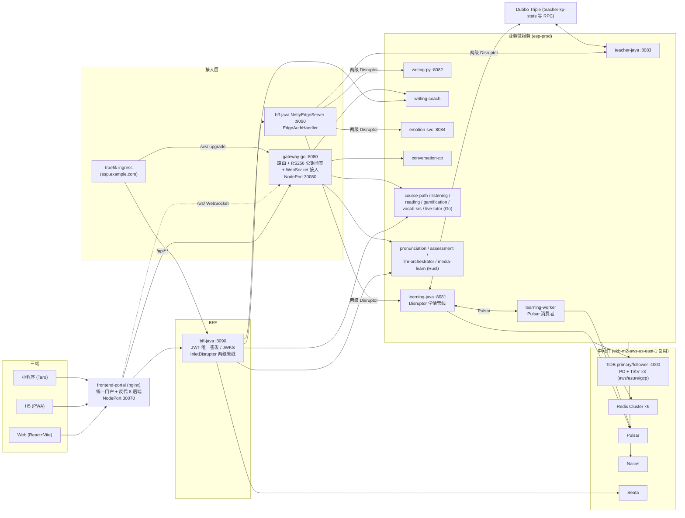
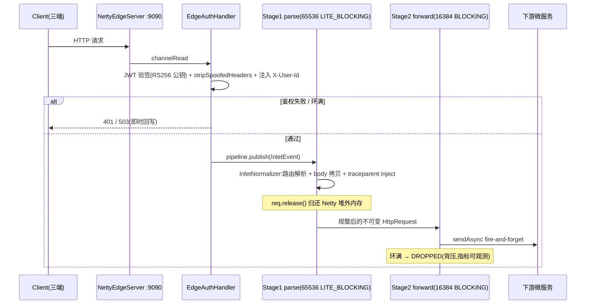
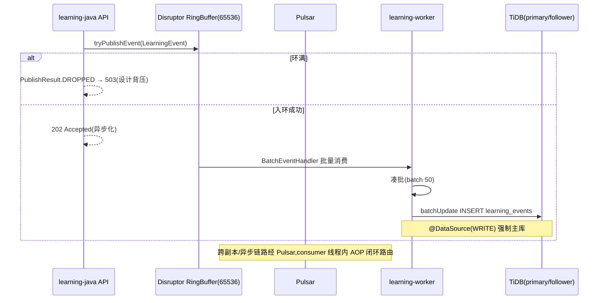
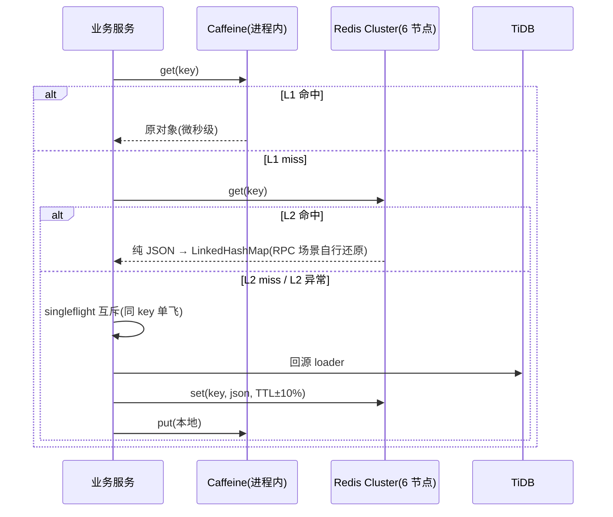
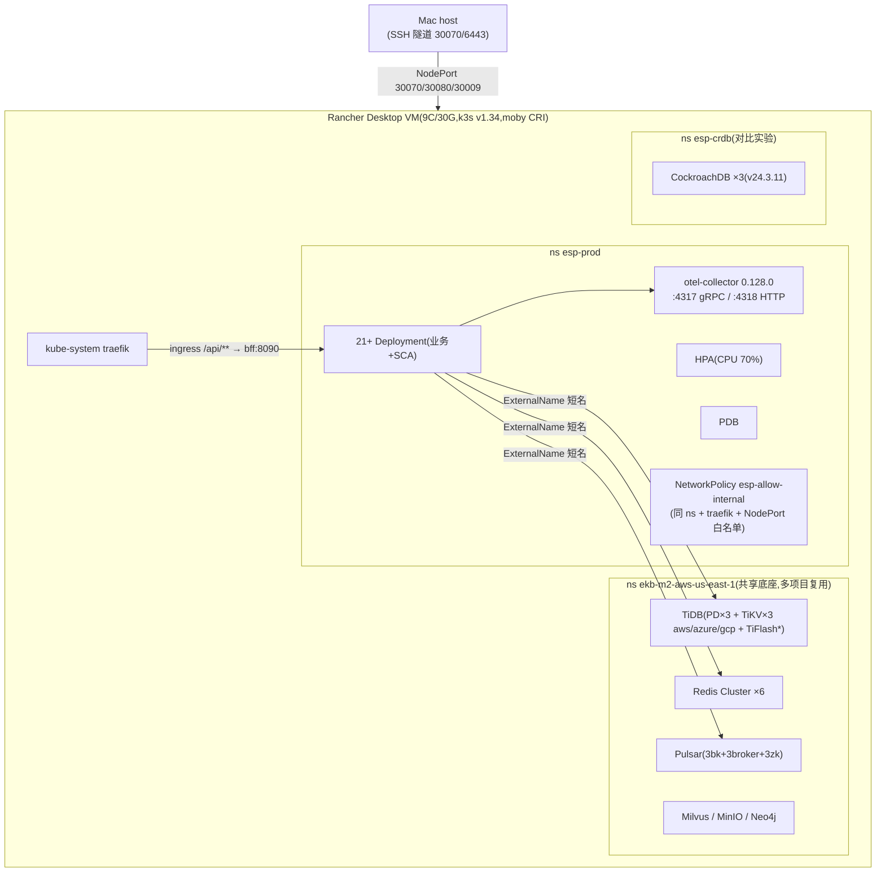
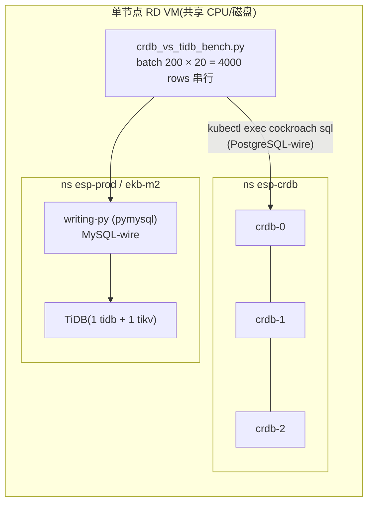
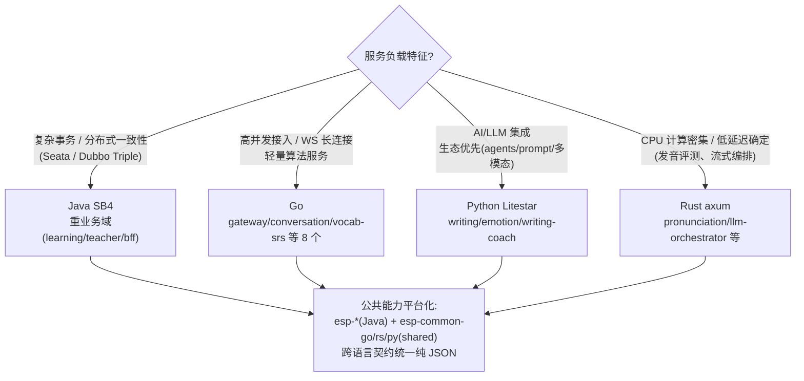
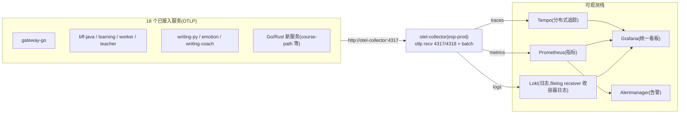

# ESP — English Study Platform (Home-Tutor)

[🇬🇧 English](README.md) | [🇨🇳 简体中文](README.zh-CN.md)


> **AI 英语教育平台(Home-Tutor / ESP)**——以教授级工业标准构建的多语言微服务平台:
> 19 个业务服务(Go / Java / Python / Rust)+ TiDB 读写分离 + Redis Cluster + Pulsar 事件总线 + LMAX Disruptor 双管线 + Netty 边缘接入,
> 目标 **5000 CCU、三端(Web / H5 / 小程序)、30 亿行测试数据**,全测试阶段可人工测试,单节点验证拓扑、可整体移植多节点。

---

## 目录

- [核心特性](#核心特性)
- [系统架构](#系统架构)
- [技术选型](#技术选型)
- [目录结构](#目录结构)
- [快速开始](#快速开始)
- [核心设计深度解析](#核心设计深度解析)
- [CRDB vs TiDB:压测对比与选型决策(实测)](#crdb-vs-tidb压测对比与选型决策实测)
- [四语言(Java/Go/Python/Rust)全方位对比](#四语言javagopythonrust全方位对比)
- [可观测性架构](#可观测性架构)
- [测试体系](#测试体系)
- [性能实测数据](#性能实测数据)
- [路线图](#路线图)
- [贡献约定](#贡献约定)

---

## 核心特性

| 维度 | 亮点 |
|---|---|
| **多语言微服务矩阵** | 19 个业务服务:Java Spring Boot 4(learning/teacher/bff)、Go(gateway/conversation 等 8 个)、Python Litestar(writing/emotion/writing-coach)、Rust axum(pronunciation/assessment/llm-orchestrator/media-learn) |
| **高性能入口** | Netty 边缘接入(9090)+ **两级 LMAX Disruptor 管线**(parse 65536 LITE_BLOCKING → forward 16384 BLOCKING),fire-and-forget 背压(环满快速 503) |
| **事件驱动** | Pulsar 事件总线(3 broker + 3 bookie + 3 zk)+ Disruptor 批量落库(batchUpdate),学情事件异步化 202 |
| **存储** | TiDB v8.5(PD/TiKV 跨 aws/azure/gcp 三区域)+ 读写分离(`esp-rw-java` RoutingHolder / `@DataSource` AOP)+ schema-per-service 演进 |
| **多级缓存** | Caffeine L1 + Redis Cluster L2(6 节点真集群,hostname announce),TTL ±10% 随机抖动防雪崩 + singleflight 防击穿,纯 JSON 跨语言契约 |
| **安全** | RS256 JWT(BFF 唯一签发,sign/verify secret 公私钥分离)、JWKS 发布、IDOR 修复、httpOnly cookie、register 锁 role、NetworkPolicy 收窄、NodePort 收敛 |
| **可观测** | OTel Collector(0.128.0)三 pipeline(traces/metrics/logs)→ Tempo / Prometheus / Grafana / Loki + Alertmanager |
| **弹性** | HPA(CPU 70%)+ PDB + 慢启动容忍(JVM 服务 ~90s);manifest 全套 Kustomize 风格编号 |
| **工程化** | GitHub Actions 9 jobs(java-commons/java-services/go-gateway/python-services/go-services/build-images/contract/e2e/frontend)+ trivy 安全扫描 + jacoco 覆盖率门禁 |
| **DDD** | 充血聚合模型(`UserMastery.applyEvent` / `Submission.grade`),domain 包拆 aggregate/valueobject/domainevent/repository |

---

## 系统架构



> 基础设施通过 ExternalName 短名(`tidb-primary`/`tidb-follower`/`redis-cluster`/`pulsar-broker`)跨 namespace 复用,见 `deploy/k8s/05-infra-reuse.yaml`、`deploy/k8s/05b-platform-infra-externalnames.yaml`。

---

## 技术选型

| 组件 | 选型 | 理由 |
|---|---|---|
| 网关/BFF | Go gin(gateway-go)+ Java Netty/Disruptor(bff-java) | WS 长连接走 Go(轻量高并发);鉴权签发与编排走 Java(生态成熟);边缘统一 Netty |
| 业务服务语言 | Java SB4 / Go / Python Litestar / Rust axum | 按负载特征选型:JVM 重业务、Go 轻并发、Python 接 LLM、Rust 高 CPU 密集(发音评分/编排);详见[四语言对比](#四语言javagopythonrust全方位对比) |
| 数据库 | TiDB v8.5(MySQL 协议,HTAP) | 水平扩容 + 兼容 MySQL 生态;PD/TiKV 跨三区域模拟多 AZ;AUTO_RANDOM 主键防热点;CockroachDB 已实测对比后否决(见[专章](#crdb-vs-tidb压测对比与选型决策实测)) |
| 读写分离 | 自研 `esp-rw-java`(`@DataSource` AOP + RoutingHolder) | 显式标注读写意图;多节点真 Follower 路由预留 SQL Hint `/*+MASTER*/` 演进位 |
| 缓存 | Caffeine(L1)+ Redis Cluster 6 节点(L2) | L1 微秒级本地读;L2 跨服务一致;纯 JSON 序列化契约(Go/Python 可直接 json.loads) |
| 消息 | Pulsar(geo-replication 方案备) | 分层存储、多租户、Bookie 扩容路径;学情事件削峰 |
| 高性能队列 | LMAX Disruptor(两级 pipeline) | 无锁 RingBuffer,背压语义明确(环满 DROPPED→503,保护网关延迟) |
| RPC | Dubbo Triple + HTTP REST | Triple 支持 OTel trace 自动传播(已实证闭合);REST 对三端友好 |
| 事务 | Seata(AT,已备 Saga 演进 ADR) | 跨服务最终一致;`adr-seata-at-to-saga.md` 预留长事务路径 |
| 注册/配置 | Nacos | 服务发现 + 动态配置 |
| 可观测 | OTel Collector → Tempo/Prometheus/Grafana/Loki | traces/metrics/logs 三 pipeline 统一采集;filelog receiver 收容器日志 |
| 部署 | K8s(k3s/Rancher Desktop 单节点验证) | manifest 全套编号化,可直接移植多节点;HPA+PDB 弹性 |
| 压测 | Locust(分布式)+ k6(Go 自研静态二进制) | 集群内 ClusterIP 直连绕过 port-forward,工业级压测姿势 |

---

## 目录结构

```text
English-Study-Platform/
├── backend/
│   ├── services/                  # 19 个业务服务
│   │   ├── bff-java/              # BFF:Netty 边缘 + Disruptor 两级管线 + JWT 签发
│   │   ├── learning-java/         # 自适应学习:Disruptor 学情管线 + 读写分离
│   │   ├── teacher-java/          # 教师端:DDD 充血 + Dubbo Triple
│   │   ├── gateway-go/            # 路由 + RS256 验签 + WebSocket
│   │   ├── conversation-go/       # 对话逻辑(自 gateway 下沉)
│   │   ├── course-path-go/ listening-go/ reading-go/
│   │   ├── gamification-go/ vocab-srs-go/ live-tutor-go/
│   │   ├── writing-py/            # 写作批改(Litestar/FastAPI + LLM)
│   │   ├── emotion-svc/           # 情感化多模态
│   │   ├── writing-coach/         # 写作教练(Python)
│   │   ├── pronunciation-rs/ assessment-rs/
│   │   ├── llm-orchestrator-rs/ media-learn-rs/
│   │   └── integration-tests/     # 契约/集成测试
│   └── shared/                    # esp-common-go / esp-common-rs / esp-cache-py / esp-db-py
├── platform/                      # Java 平台底座
│   ├── esp-api/                   # API 契约
│   ├── esp-cache/                 # 多级缓存(TTL 抖动 + singleflight + 幂等 Filter)
│   ├── esp-disruptor/             # 多级 Disruptor pipeline 抽象
│   └── esp-rw-java/               # 读写分离(@DataSource AOP + RoutingHolder)
├── apps/                          # 前端 monorepo(pnpm + turbo)
│   ├── web/ h5/ miniprogram/      # @esp/web @esp/h5 @esp/miniprogram
├── packages/                      # types / api-client / ws-client / ui-tokens
├── frontend-portal/               # 统一门户(nginx 反代 8 后端)
├── deploy/
│   ├── k8s/                       # 生产 manifest(编号化,见下)
│   ├── docker/                    # docker-compose 本地全栈
│   ├── locust/                    # 分布式压测(README 含 G-01/G-04/G-06 场景)
│   └── crdb/                      # CockroachDB 3 节点对比实验
├── e2e/                           # Playwright 冒烟 E2E
├── docs/
│   ├── design/                    # SRS/SAD/SDD + 30+ ADR/SRS/SDD/方案文档
│   ├── test/                      # 00 总览 ~ 09 人工测试操作指南
│   ├── api/ product/ progress/
│   └── PROGRESS.md                # 跨会话进展热区(铁律:状态必落盘)
├── scripts/                       # db_query.sh / seed_3b.py / crdb_vs_tidb_bench.py / redis-warmup.py 等
├── report/                        # 压测/基准实测产物(csv/json/html)
└── .github/workflows/             # ci.yml(9 jobs)+ security.yml(trivy)
```

`deploy/k8s/` 关键 manifest(真实文件):

| 文件 | 内容 |
|---|---|
| `00-namespace-secret.yaml` / `00b-rsa-jwt-secrets-split.yaml` | namespace + RS256 sign/verify 公私钥分离 secret |
| `05-infra-reuse.yaml` / `05b-platform-infra-externalnames.yaml` | 跨 ns 基础设施 ExternalName 复用 |
| `06-sca-middleware.yaml` | Nacos + Seata + Sentinel |
| `07-tidb-tikv.yaml` | TiDB/TiKV/PD(跨三区域) |
| `10-gateway-go.yaml` / `15-bff-java.yaml` / `20-learning-java.yaml` / `21-learning-worker.yaml` | 核心四件 |
| `30-other-services.yaml` / `31-new-services.yaml` / `32-batch2-services.yaml` / `33-orchestrator-vocab.yaml` | teacher/emotion/writing + Go/Rust 新服务矩阵 |
| `15/16/17-frontend*.yaml` | web / h5 / portal |
| `40-ingress.yaml` / `40-networkpolicy.yaml` / `40b-traefik-ratelimit.yaml` | ingress + NetworkPolicy + traefik 限流 |
| `41-pdb.yaml` / `50-hpa.yaml` | PDB + HPA |
| `95-otel-collector.yaml` | OTel Collector(traces/metrics/logs) |
| `esp-redis-warmup-job.yaml` / `16-seed-session-turns.yaml` | Redis 预热 / 种子数据 Job |

---

## 快速开始

### 环境要求

- K8s:Rancher Desktop(k3s v1.34+,VM ≥ 8C/30G,本项目实测 9C/30G)
- 基础设施 namespace `ekb-m2-aws-us-east-1`:TiDB(v8.5,root 无密码,DB `esp`)、Redis Cluster(6 节点)、Pulsar、Milvus/Neo4j/MinIO(平台底座复用)
- 工具:kubectl、docker(RD VM 内构建)、JDK 21+、Go 1.25(注意 `env -u GOROOT GOTOOLCHAIN=local` 绕 gvm 坑)、Python 3.12/3.13、Rust 1.88、node/pnpm
- 详见 `deploy/k8s/README-infra.md`

### 部署步骤(apply 顺序,已实测)

```bash
NS=esp-prod

# 1) namespace + 密钥(RSA 私钥仅 BFF;verify secret 只有公钥)
kubectl apply -f deploy/k8s/00-namespace-secret.yaml
kubectl apply -f deploy/k8s/00b-rsa-jwt-secrets-split.yaml   # 注意:勿 apply 空占位覆盖已灌真实 PEM

# 2) 基础设施复用 + SCA 中间件
kubectl apply -f deploy/k8s/05-infra-reuse.yaml
kubectl apply -f deploy/k8s/05b-platform-infra-externalnames.yaml
kubectl apply -f deploy/k8s/06-sca-middleware.yaml
kubectl apply -f deploy/k8s/07-tidb-tikv.yaml

# 3) 业务服务(编号顺序)
kubectl apply -f deploy/k8s/10-gateway-go.yaml
kubectl apply -f deploy/k8s/15-bff-java.yaml
kubectl apply -f deploy/k8s/15-frontend-react.yaml -f deploy/k8s/16-frontend-h5.yaml -f deploy/k8s/17-frontend-portal.yaml
kubectl apply -f deploy/k8s/20-learning-java.yaml -f deploy/k8s/21-learning-worker.yaml
kubectl apply -f deploy/k8s/30-other-services.yaml -f deploy/k8s/31-new-services.yaml
kubectl apply -f deploy/k8s/32-batch2-services.yaml -f deploy/k8s/33-orchestrator-vocab.yaml

# 4) 边界与弹性
kubectl apply -f deploy/k8s/40-ingress.yaml -f deploy/k8s/40-networkpolicy.yaml -f deploy/k8s/40b-traefik-ratelimit.yaml
kubectl apply -f deploy/k8s/41-pdb.yaml -f deploy/k8s/50-hpa.yaml
kubectl apply -f deploy/k8s/95-otel-collector.yaml

# 5) 种子 + Redis 预热
kubectl apply -f deploy/k8s/16-seed-session-turns.yaml        # 种子 Job(见 deploy/seed-job.yaml)
kubectl apply -f deploy/k8s/esp-redis-warmup-job.yaml
```

> Java 服务慢启动(Nacos+Dubbo+Seata ~90s),readiness 探针已按 10s/10fail 放宽,勿提前判定失败。

### 访问入口

| 入口 | 地址 |
|---|---|
| 统一 Portal(Web/H5/小程序预览 + API 反代) | `http://localhost:30070`(RD 单节点需 SSH 隧道:`ssh -f -N -L 30070:localhost:30070 -F "$HOME/Library/Application Support/rancher-desktop/lima/0/ssh.config" lima-0`) |
| gateway-go(API/WS) | NodePort `30080` |
| bff-java | NodePort `30009`(MVC)/ `30010`(edge) |

### 本地开发

```bash
# 前端 monorepo
pnpm install && pnpm turbo typecheck

# Java(公共包先 install)
cd platform && mvn -B install -DskipTests -pl esp-api,esp-cache,esp-rw-java,esp-disruptor
cd backend/services/learning-java && mvn test

# Go(workspace 模式,注意 GOROOT 坑)
env -u GOROOT GOTOOLCHAIN=local go test ./services/... ./shared/...

# Python
cd backend/services/writing-py && pip install -e ".[test]" && python -m pytest

# docker-compose 本地全栈
cd deploy/docker && docker compose up -d
```

---

## 核心设计深度解析

### 1. 两级 Disruptor 管线(bff-java 边缘)

Stage1 `parse`(InletNormalizer,环 65536 + LITE_BLOCKING):纯计算微秒级——路由解析、body 拷出 Netty ByteBuf(拷完即 `release()` 归还堆外内存)、header 白名单过滤、traceparent W3C inject。
Stage2 `forward`(DownstreamForwarder,环 16384 + BLOCKING):纯 IO 派发(JDK HttpClient sendAsync fire-and-forget);小环天然限制在途 body 拷贝总量防内存放大;环满 `forward` 返回 DROPPED → 503 快速背压。

WaitStrategy 选型:Stage1 LITE_BLOCKING(先自旋后挂起,突发低延迟且闲时不烧 CPU);Stage2 BLOCKING(IO 密集对唤醒延迟不敏感,最省 CPU)。



### 2. 读写分离 + Disruptor 批量落库(learning-java)

- 入口:HTTP 202 异步化,学情事件进 `LearningEvent` RingBuffer(65536);
- 消费:`DbLearningEventConsumer` JdbcTemplate batchUpdate(batch_size=50,`order_inserts/order_updates=true`,不含 id 列交 TiDB AUTO_RANDOM);
- 连接池:HikariCP 写 20 + 读 20 + shared 10;
- 路由:`@DataSource(WRITE/READ)` AOP → RoutingHolder → tidb-primary / tidb-follower(单节点同库,多节点真副本路由已预留)。



### 3. JWT 安全收敛(RS256 公私钥分离)

BFF 是唯一签发方(持有私钥的 secret `esp-rsa-jwt-sign` 仅 bff-java envFrom);gateway/learning/teacher 只拿公钥(`esp-rsa-jwt-verify`,verify-only)。任一业务服务 RCE 也无法伪造 admin JWT。BFF 通过 JWKS(kid=esp-rs256-1)发布公钥。边缘剥离伪造 `X-User-Id` 并注入 JWT sub;IDOR 修复后 userID 一律取自 JWT。

```mermaid
sequenceDiagram
    participant U as 用户(三端)
    participant B as bff-java(唯一持私钥)
    participant K as JWKS端点
    participant G as gateway-go / learning / teacher(仅公钥)

    U->>B: POST /api/auth/login
    B->>B: RS256 签发 JWT(sub=uid, role 服务端锁定)
    B-->>U: Set-Cookie esp_token(HttpOnly; SameSite=Strict; Max-Age=7d)+ Bearer 兼容
    B->>K: 发布公钥(JWKS, alg=RS256)
    U->>G: 请求(Bearer 或同源 cookie)
    G->>K: 拉取公钥
    G->>G: 验签 + ParseUserID → 拒绝伪造 X-User-Id
    Note over G: 过期/无效 → 401;越权 session → 403(WS upgrade 前)
```

### 4. 多级缓存(Caffeine L1 + Redis Cluster L2)

- 纯 JSON value 契约(去 DefaultTyping,无 Java FQCN 嵌入),Go `json.Unmarshal` / Python `json.loads` 直接可读;
- TTL ±10% 随机抖动防雪崩 + singleflight 互斥防击穿;L2 读异常 catch 降级回源 DB;
- 预热:`esp-redis-warmup` Job 1.5s 灌入 23000 键(scenarios/kp top10000 + sessions/mastery/users top1000,TTL 1h)。



### 5. 部署拓扑(单节点验证,多节点可移植)



> TiFlash 单节点跨 region raft proxy 启动缺陷未注册 PD,业务无列存依赖,标记已知缺陷待多节点重建。

---

## CRDB vs TiDB:压测对比与选型决策(实测)

> 兑现审计项 #108:"添加一套 CockroachDB 多区域节点方案并对比实际全链路压测对比 TiDB"。
> 方案文档:`docs/design/cockroachdb-vs-tidb-multi-region-plan.md`;实测产物:`report/crdb-smoke-loadtest.json`、`report/crdb-vs-tidb-app-bench.json`。

### 实验环境与压测方案

- **集群**:ns `esp-crdb`,3 副本 StatefulSet `crdb-0/1/2`,CockroachDB v24.3.11 **arm64**(RD VM 为 aarch64,amd64 镜像经 qemu 转译 SIGSEGV);manifest `deploy/crdb/crdb-3node.yaml`。
- **关键坑**:`--join=crdb-0.crdb,...` 依赖 headless svc `publishNotReadyAddresses: true`,否则 not-ready pod 不发布 DNS → bootstrap 卡死。
- **schema 适配**(`deploy/crdb/schema-crdb.sql`):TiDB `AUTO_RANDOM` → CRDB `unique_rowid()`;`ENUM` → `VARCHAR+CHECK`;`TINYINT` → `SMALLINT`;`DATETIME(3)` → `TIMESTAMP(3)`;`JSON` 保留;删 `ON UPDATE CURRENT_TIMESTAMP`(CRDB 无此子句)。覆盖 5 核心表:users / scenarios / sessions / session_turns / learning_events。
- **压测工具与模型**:
  - 冒烟:`scripts/seed_crdb.py` 种子 + kube-exec 逐查询 bench(有 per-query exec 开销);
  - 应用层对比:`scripts/crdb_vs_tidb_bench.py`,**batch INSERT 200 rows/批,共 4000 rows 串行**,经应用连接路径(CRDB 走 `kubectl exec crdb-0 -- cockroach sql`,TiDB 走 writing-py pymysql 2.2.8),单次 exec 进程启动开销用 batch 摊薄;
  - 读写比:本轮以**写路径为主**(learning_events 追加是 5000 CCU 下主要写负载,G-06 目标 5000 ev/s);读路径冒烟含 point/range;
  - **环境限制(如实)**:单节点 RD VM,3 CRDB pod 与 TiDB 共享同一 VM CPU/磁盘 —— 这是**可行性 + 量级对比**,非生产容量结论。
- **协议差异**:CRDB 是 PostgreSQL-wire,ESP 集群无 psycopg2/psql 客户端 pod(Python 侧仅 pymysql,MySQL-wire 不兼容)。

### 实验拓扑



### 结果数据(全部实测)

**冒烟级(经 kube-exec,开销主导,仅量级参考)** — `report/crdb-smoke-loadtest.json`:

| 项 | 值 | 说明 |
|---|---|---|
| 种子 | 100 users / 3 scenarios / 500 sessions / 2000 turns / 2000 events | `scripts/seed_crdb.py` |
| write bench | 2000 rows / 25.45s / **78.6 insert/s** | |
| point read | 100 queries / 126.58s / 0.8 qps | exec per-query 开销主导,非真实 QPS |
| range read | 1345.9 ms(count=36) | |

**应用层写吞吐对比(核心结论)** — `report/crdb-vs-tidb-app-bench.json`:

| 指标 | CockroachDB v24.3.11(3 副本) | TiDB v8.5 | ratio(CRDB/TiDB) |
|---|---|---|---|
| 数据量 | 4000 rows(batch 200) | 4000 rows(batch 200) | — |
| 耗时 | 28.77 s | 15.42 s | — |
| **写吞吐** | **139.0 insert/s** | **259.3 insert/s** | **0.54** |

### 多区域对比维度(方案层,待真多节点实测)

按 plan 设计,真实多区域对比需 **3 master + 6 worker** 集群(plan §4 方法论),维度包括:

1. **写吞吐门槛(硬性出局制)**:CRDB 组 G-06 须 ≥5000 ev/s 且写路径 P99 <200ms;
2. **共识延迟 vs 本地读**:跨区域 Raft 共识延迟 50~100ms;ESP 写路径(learning_events 追加)已 202 异步化 + outbox,对单条延迟不敏感——吞吐受 Raft 提交流水线而非 RTT 限制;真正敏感的是对话内强一致读(会话恢复 / mastery 查询),CRDB RBR 本地读 <5ms 优于现状;
3. **协议生态**:TiDB MySQL-wire 与存量 Java(JDBC)/Go(mysql)/Python(pymysql)栈零改动;CRDB 需引入 PostgreSQL 驱动体系;
4. **运维复杂度**:arm64 镜像适配、headless DNS bootstrap 坑、无现成 TiCDC 等同步工具链衔接。

### 结论与最终选型

- **单节点实测**:CRDB 写吞吐仅为 TiDB 的 **0.54 倍**,实证 plan 结论——**"5000 CCU 尺度下,引入 CRDB 的收益不成立"**;
- **决策**:**最终选型 TiDB**(MySQL 生态零迁移成本 + 已有读写分离/批量写优化落地);CRDB 保留 3 节点实验环境(`ns esp-crdb`)与全量脚本/manifest,待真多区域集群(3m+6w)条件具备时按 plan §4 复测;
- 审计登记册 #108 由此闭合(`docs/design/audit-gap-resolution-register.md`)。

---

## 四语言(Java/Go/Python/Rust)全方位对比

本项目 19 个业务服务按负载特征分配四种语言,以下对比全部基于项目真实使用与实测记录。

### 各语言在项目中的定位

| | Java(Spring Boot 4) | Go | Python | Rust |
|---|---|---|---|---|
| **服务**(数量) | bff-java / learning-java(+worker)/ teacher-java(3) | gateway / conversation / course-path / listening / reading / gamification / vocab-srs / live-tutor(8) | writing-py / emotion-svc / writing-coach(3) | pronunciation / assessment / llm-orchestrator / media-learn(4) |
| **框架/运行时** | Spring Boot 4 + Netty + LMAX Disruptor | gin | Litestar + Granian | axum + tokio |
| **典型场景** | 复杂业务事务 + Dubbo Triple RPC + Seata 分布式事务 + DDD 充血领域模型 | 高并发网关、WebSocket 长连接、轻量 CRUD/算法服务(SM2 间隔重复) | AI/LLM 集成(写作批改、情感多模态、教练编排) | 计算密集(发音评测)、LLM 编排、媒体处理 |
| **并发模型** | JVM 线程池(HikariCP/MVC)+ Netty EventLoop + Disruptor 无锁 RingBuffer | goroutine(CSP channel) | asyncio 事件循环 | tokio 异步运行时(future) |
| **启动速度** | **慢:~90s**(Nacos+Dubbo+Seata 慢启动;探针放宽 10s/10fail) | 秒级(精确值实测待补) | Granian 冷启动慢(观测;精确值实测待补) | 秒级(精确值实测待补) |
| **资源画像** | requests ~250m/512Mi 起,bff CPU limit **2 核**(探针误杀后从 1 核上调) | 轻量:vocab-srs-go **100m/128Mi ~ 500m/256Mi**(manifest 实测) | python:3.13-slim 基镜像,资源紧(精确值实测待补) | llm-orchestrator-rs **250m/256Mi ~ 1C/512Mi**(manifest 实测) |
| **生态成熟度(中间件客户端)** | 最全:Dubbo Triple/Seata/Nacos/Spring Cloud Alibaba + 自研 esp-* 平台包(esp-cache/esp-rw/esp-disruptor/esp-api) | 齐:miniredis/pulsar/mysql/websocket/redis/otel(conversation-go 依赖清单) | pymysql 2.2.8 + 自研 esp-cache-py/esp-db-py;**无 psycopg2**(MySQL-wire only) | axum/tokio + 自研 esp-common-rs 共享 crate;LLM provider SDK 自研(StubProvider 兜底) |
| **本项目单测** | learning **48** / teacher **16** / bff(Disruptor 管线 3 + RouteTable 5 等);覆盖率 learning 40.5% / teacher 23.6% / bff 30.6% | **25 tests / 4 模块**(vocab-srs 14 + course-path 6 + esp-common-go 4 + gamification 2);另 2 模块耦合全局 DB 待 DI 重构 | writing-py **18 passed**(pytest + ruff 门禁) | **未建**(实测待补) |
| **镜像** | eclipse-temurin:21-jre-alpine(prebuilt fat-jar) | golang:1.25-alpine builder → alpine:3.22 runtime | python:3.13-slim | rust:1.88-bookworm builder → debian:bookworm-slim runtime |
| **构建时间** | 主机 mvn(单节点铁律:与集群操作串行;精确值实测待补) | 极快(精确值实测待补) | pip install -e ".[test]" 快 | llm-orchestrator-rs docker build 实测 **1m44s** |
| **踩坑实录** | SB3.5→4.0.7 三破坏性变更;JaCoCo×JDK25 class file 69 兼容;esp-cache provided 坑 | gvm GOROOT 坑(`env -u GOROOT GOTOOLCHAIN=local`) | venv extras 命名坑(`[test]` 非 `[dev]`);.venv 符号链接致 docker context xattr 失败 | Cargo path 相对解析坑(Dockerfile COPY 路径);deb.debian.org 出口偶发不通换 mirrors.ustc.edu.cn |

### 选型原则:什么场景用什么语言



配套文字原则(按序判断):

1. **默认入口/路由/长连接 → Go**:goroutine 每连接成本远低于 JVM 线程,镜像/内存小一个量级(本项目 vocab-srs-go 128Mi vs bff 2C);
2. **重业务域(多实体事务、TCC/Saga、领域规则密集)→ Java**:事务/RPC/ORM 生态最成熟,DDD 充血模型有 Spring 生态支撑;代价是 ~90s 慢启动与最高内存,须配慢启动探针与串行构建纪律;
3. **LLM/AI 边界 → Python**:模型 SDK 与 Agent 生态首发即 Python;性能瓶颈在外部 LLM API,语言本身不是瓶颈;
4. **计算密集且延迟确定(实时发音评分)→ Rust**:tokio 高密度并发 + 无 GC 抖动;代价是构建慢(1m44s)与驱动生态需自研补齐;
5. **跨语言共享一律走契约而非共享库**:缓存/消息 value 纯 JSON、API 走 REST/Dubbo Triple、类型单真源在 `packages/types`——避免任何语言私有序列化格式泄漏。

---

## 可观测性架构



- **trace 实证**:前端 → BFF traceparent 闭合;Dubbo Triple trace 自动传播闭合(`docs/test/05-traceId实测.md`);
- 多节点演进:collector gateway / daemonset 分层 manifest 已备(`deploy/k8s/otel-collector-gateway.yaml`、`otel-collector-daemonset.yaml`);
- 告警部署见 `docs/test/05-监控告警部署说明.md`。

---

## 测试体系

| 层级 | 内容 | 出处 |
|---|---|---|
| 单元测试 | Java(learning 48 / teacher 16 / esp-cache 15,覆盖率门禁:esp-cache 77%≥75%;业务服务基线 learning 40.5% / teacher 23.6% / bff 30.6%);Go 25 tests(4 模块,SM2 算法全路径);Python writing-py 18 passed;前端 Vitest | `docs/test/01-单元测试报告.md` |
| 集成/契约 | Dubbo Triple 契约测试、`integration-tests/`、writing Mock 批改链路 | `docs/test/02-集成测试报告.md` |
| 性能压测 | Locust 分布式 + k6 基线 + WS CCU 脚本(`ccu5000_ws.py`/`spike.py`/`soak.py`),G-01/G-04/G-06 SLO | `docs/test/03-性能与压测报告.md`、`deploy/locust/README.md` |
| 混沌测试 | chaos-plan 已设计 | `docs/test/04-混沌测试报告.md`、`chaos-plan.md` |
| 监控告警 | Prometheus/Grafana/Alertmanager 部署验证 | `docs/test/05-监控告警部署说明.md` |
| 安全测试 | SEC-1~8 矩阵(WS 越权 403/过期 JWT 401/X-User-Id 剥离/JWKS 闭环/trivy 零泄漏)全绿 | `docs/test/06-安全测试报告.md` |
| 人工测试 | **73 条人工用例**(TC-GR 27 条 8 服务全端点 + TC-W/H 前端 + TC-E2E 11 条跨服务链路 + SEC 补充),操作指南含 portal 隧道命令 | `docs/test/07-人工测试用例.md`、`09-人工测试操作指南.md` |
| 前端核查 | 三端 build/白屏/token 链路 | `docs/test/08-前端核查报告.md` |
| E2E | Playwright 冒烟(首页加载/无 token 401)scaffold 级 | `e2e/` |

---

## 性能实测数据

> 全部来自 `report/` 实测产物与 `docs/PROGRESS.md` / 压测报告,单节点 Rancher Desktop(9C/30G)环境,**未达项如实标注**。

### SLO 目标 vs 实测(G-01/G-02/G-04/G-06)

| SLO | 目标 | 实测(单节点) | 状态 |
|---|---|---|---|
| G-01 WS CCU | 5000 | **峰值 372**(500 用户压测);单节点可持续 ~62 并发(瓶颈=bff-java register 单核) | 未达(多节点容量验证方案已备:`docs/design/multi-node-capacity-validation-plan.md`) |
| G-02 口语 P95 | <800ms | scenarios P95 90ms(非真实 ASR/LLM 链路) | 参考值 |
| G-04 写作 | ≥50 rps,P95<2s | writing/grade **24 rps,P95=95ms**(P95 达标,rps 未达) | 部分达标 |
| G-06 学情事件 | ≥5000 ev/s | **2482 ev/s**(早期 277 → 优化后 2482;200VU 持续负载 ~760 ev/s 触发设计背压 503) | 未达(learning-worker 1→3→5 副本水平分片为多节点前置) |

### 其他实测基线

- **k6 基线(bff-java /api/scenarios)**:50 VUS 529 rps / 平均 1.61ms;100 VUS 903 rps / 98% / 19.83ms;200 VUS 1392 rps / 99.95% / 74.72ms;
- **Locust 200 VU 混合场景**(140,430 reqs):平均 780 rps,**聚合 P95=95ms / P99=150ms**,非 learning 端点全绿;
- **CRDB vs TiDB 写吞吐对比**:CRDB 139.0 insert/s vs TiDB 259.3 insert/s,ratio 0.54 → 5000 CCU 尺度 CRDB 收益不成立(详见[专章](#crdb-vs-tidb压测对比与选型决策实测));
- **Redis warm-up**:23000 键 1.5s 灌完;
- **种子数据**:目标 30 亿行(TiDB 关键高频表),分表补灌推进中(sessions 达标;session_turns 补灌至千万级,见 git log 会话22-8 系列);
- **trace/exporter**:OTel 接入后 14 服务近 3 分钟导出错误 0 条(改造前 gateway-go 每 10~15s 一条 export timeout)。

---

## 路线图

按审计登记册(`docs/design/audit-gap-resolution-register.md`,31 项承诺 = 16 完成 / 7 待环境 / 8 仅方案):

- [x] P0 安全红线 6 项(私钥收敛/服务鉴权/IDOR/role 锁/NodePort 收敛/NetworkPolicy)
- [x] P1 容量质量 6 项 + P2 架构深化 7 项(DDD 充血/gateway 瘦身/缓存防护/目录重组/前端 monorepo/工程化)——19/19 闭合
- [x] A 类审计项全闭合(CRDB 实测/Disruptor 多级/esp-cache 纯 JSON/DB 吞吐/OTel 接入/CI 修绿)
- [ ] B 类(多节点触发):Cilium CNI / Pulsar Geo-Replication / TiCDC 异地多活 / 真 Follower 读写分离 / 多节点容量验证(G-01/G-06 达标复测)
- [ ] C 类(独立引入决策):Loki 落地 / ArgoCD GitOps / Milvus+Neo4j 业务接入
- [ ] D 类(测试/工程化):73 条人工用例全量执行 / 5000 CCU 压测复测 / 探针三分离 / 数字人/TTS / 个性化推荐
- [ ] 覆盖率提升迭代(Go 剩余模块 DI 重构 / Java ≥80% / E2E 完整化)

---

## 贡献约定

1. **状态必落盘**:进度/决策/坑写 `docs/PROGRESS.md`(热区)+ `docs/progress/archive/`(历史),对话只是临时工作区;
2. **文档分层**:`docs/design/`(SRS/SAD/SDD/ADR)→ 改架构先写/改 ADR;测试文档在 `docs/test/00~09`,回填数字必须来自 `report/`/`logs/` 实测产物,无数据写"未执行";
3. **提交规范**:`type(会话xx-y): 描述`,如 `docs(会话22-8): ...` / `fix(会话22-8): ...`;
4. **单节点铁律**:重 mvn/docker build 与集群操作串行;不碰 k3s 配置;共享基础设施(ekb-m2 ns)操作前先评估影响;
5. **密钥安全**:RS256 私钥仅 `kubectl create secret --from-literal` 灌入,声明式空占位 manifest 不得 apply 到已有真实值的 secret;
6. **CI 门槛**:`.github/workflows/ci.yml` 9 jobs 全绿 + trivy 零 HIGH;esp-cache 覆盖率 ≥75%;
7. **多语言 Dockerfile 注意**:Go 必须 `ENV GOPROXY=https://goproxy.cn,direct`;arm64 镜像注意 CRDB/Rust 基镜像架构。

---

> 设计文档索引:`docs/design/01-需求分析文档-SRS.md` / `02-系统架构设计文档-SAD.md` / `03-详细设计文档-SDD.md`,以及 30+ ADR/专项方案(读写分离、多级缓存、schema-per-service、Pulsar Geo、多区域同步、CRDB 对比、多节点容量验证等)。
