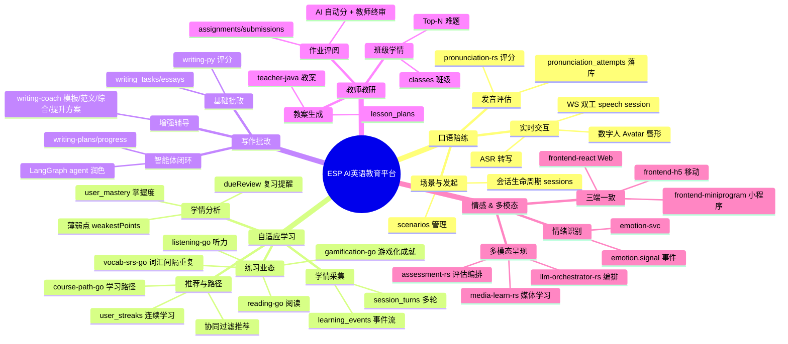

# B1 — 业务能力地图(Business Capability Map)

> TOGAF ADM Phase B(业务架构)P0 补救产出物。
> 评估视角:教授级高级工程师 / 互联网大厂资深架构师。
> 数据来源:SAD §3 DDD 服务划分 + SRS §3 功能需求 + ADR-new-services(10 新服务)。
> 日期:2026-08-13。

## 目的

把 ESP 抽象为"5 大一级能力 → 二级能力(2-3 层)→ 归属服务工程"的能力树,验证**无 orphan 服务**(每服务都能归到能力树下),作为 Phase B 价值流、应用-数据矩阵的输入。

---

## 一级能力 & 二级 / 三级分解(mermaid mindmap)

## 能力 × 服务归属矩阵(验证无 orphan)

| 一级能力 | 二级能力 | 三级能力 | 归属服务工程 | 源数据表 |
|---|---|---|---|---|
| 口语陪练 | 场景与发起 | scenarios / sessions | gateway-go | scenarios, sessions |
| 口语陪练 | 实时交互 | WS / ASR / Avatar | gateway-go(hub shard=8) | session_turns |
| 口语陪练 | 发音评估 | 评分 / 落库 | pronunciation-rs | pronunciation_attempts |
| 自适应学习 | 学情采集 | 事件流 / 多轮 | learning-java(Disruptor) + learning-worker | learning_events, session_turns |
| 自适应学习 | 学情分析 | 掌握度 / 薄弱点 / 复习 | learning-java | user_mastery |
| 自适应学习 | 推荐与路径 | 学习路径 / 推荐 / 连续 | course-path-go | user_streaks |
| 自适应学习 | 练习业态 | 听 / 读 / 词 / 游化 | listening-go / reading-go / vocab-srs-go / gamification-go | listening_*, reading_*, vocabulary, achievements |
| 写作批改 | 基础批改 | 评分 | writing-py | writing_tasks, writing_essays |
| 写作批改 | 智能体闭环 | LangGraph 润色 | writing-py(langgraph 1.2.10) | writing_plans, writing_progress |
| 写作批改 | 增强辅导 | 模板/范文/综合/提升 | writing-coach | writing_templates |
| 教师教研 | 教案生成 | lesson_plans | teacher-java | lesson_plans |
| 教师教研 | 班级学情 | classes / Top-N | teacher-java(Dubbo→learning) | classes |
| 教师教研 | 作业评阅 | assignment / 终审 | teacher-java | assignments, submissions |
| 情感多模态 | 情绪识别 | emotion-svc | emotion-svc | (emotion.signal topic) |
| 情感多模态 | 多模态编排 | media / llm / assessment | media-learn-rs / llm-orchestrator-rs / assessment-rs | assessment_sessions, assessment_answers |
| 情感多模态 | 三端一致 | Web / H5 / 小程序 | frontend-react / frontend-h5 / frontend-miniprogram | (调用上述表) |
| (横切) | 接入与鉴权 | BFF / gateway / 边缘 | bff-java / gateway-go | users |
| (横切) | 基础设施 | 注册/配置/流控/事务/缓存/DB | nacos / sentinel / seata / redis-cluster / tidb / pulsar | (基础设施) |

## 无 orphan 验证

逐一核 27 服务工程归属:
- 业务服务 11:gateway-go ✅, bff-java ✅(横切接入), learning-java ✅, teacher-java ✅, writing-py ✅, emotion-svc ✅, writing-coach ✅, course-path-go ✅, listening-go ✅, reading-go ✅, gamification-go ✅, live-tutor-go ✅(归教师教研/实时辅导), vocab-srs-go ✅
- Rust 4 新服务:assessment-rs ✅, llm-orchestrator-rs ✅, media-learn-rs ✅, pronunciation-rs ✅(情感多模态编排)
- 公共包 10:esp-api(Dubbo 契约) ✅横切, esp-common-go/rs ✅横切, esp-disruptor ✅(自适应学情采集), esp-rw-java / esp-cache / esp-cache-py / esp-db-py ✅(横切基础设施), esp-sentinel-go ✅
- 前端 3:frontend-react/h5/miniprogram ✅

**结论:27 服务工程 + 3 前端 + 10 公共包全能力归属,无 orphan**。横切能力(接入鉴权 / 基础设施)单列,与一级能力正交。

## 与 TOGAF 后续阶段对接

- **B2 价值流图**:每条价值流跨多能力(如"学习闭环"串學情采集→分析→推荐→练习→采集)。
- **C1 应用-数据矩阵**:每能力的服务 × 表 CRUD 细化。
- **G1 治理 / H1 债务**:能力覆盖完整度作为合规模板检查项;orphan = 风险登记。

## 出口条件

5 一级完整、二级 4-5 个完整、三级服务归属完整、无 orphan(已满足)。
