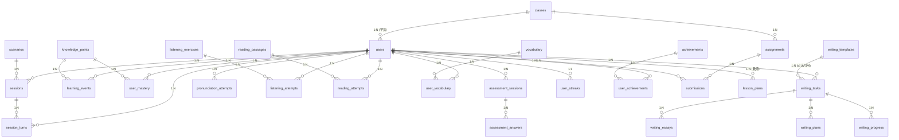

# C3 — 数据实体关系图(ER 三层:概念/逻辑/物理)

> TOGAF ADM Phase C(数据架构)P0 补救产出物。
> 评估视角:教授级高级工程师 / 互联网大厂资深架构师。
> 数据来源:`docs/design/schema.sql`(物理)+ `schema-per-service.sql` + C1 应用-数据矩阵。
> 日期:2026-08-13。

## 目的

TOGAF DA 域要求"概念/逻辑/物理"三层模型,ESP 仅物理层(schema.sql)完善。本文档补三层 ER 图,标 cardinality(1:1 / 1:N / N:M),识别 N:M 关联表。

---

## 1. 概念层(Conceptual)— 5 大主实体关系

```mermaid
erDiagram
    USER ||--o{ SESSION : "发起"
    USER ||--o{ LEARNING_EVENT : "产生"
    USER ||--o{ WRITING_TASK : "提交"
    USER ||--o{ MASTERY : "拥有"
    USER ||--o{ SUBMISSION : "完成"
    SESSION ||--o{ SESSION_TURN : "含"
    SCENARIO ||--o{ SESSION : "基于"
    KNOWLEDGE_POINT ||--o{ MASTERY : "被掌握"
    KNOWLEDGE_POINT ||--o{ LEARNING_EVENT : "关联"
    CLASS ||--o{ USER : "包含学员"
    CLASS ||--o{ ASSIGNMENT : "布置"
    ASSIGNMENT ||--o{ SUBMISSION : "产生"
    TEACHER ||--o{ CLASS : "执教"
    TEACHER ||--o{ LESSON_PLAN : "编写"
    WRITING_TASK ||--o{ WRITING_ESSAY : "含"
    WRITING_TASK ||--o{ WRITING_PROGRESS : "进度"
```

**5 大主实体**:USER(学员/教师)/ SESSION(口语会话)/ LEARNING_CONTENT(知识点/场景/写作/听力/阅读/词汇)/ EVENT(学习事件/会话轮次)/ ASSESSMENT(作业/评估/教案)。

## 2. 逻辑层(Logical)— 11+ 业务实体 cardinality



### N:M 关系(经关联表实现)

| N:M 关系 | 关联表 | 说明 |
|---|---|---|
| users × knowledge_points | **user_mastery** | 学员对每知识点的掌握度(N:M,每行一个 user×kp) |
| users × vocabulary | **user_vocabulary** | 学员词汇本(N:M,每行 user×vocab) |
| users × achievements | **user_achievements** | 学员成就发放(N:M) |
| classes × users | classes.user_ids(JSON/关联) | 班级×学员(N:M,JSON 存或关联表) |

## 3. 物理层(Physical)— 直接引 schema.sql

物理层即 `docs/design/schema.sql`(13 核心表)+ `schema-per-service.sql`(分库 30 表),DDL 直读不再重复。关键物理特性:

| 特性 | 落地 | 大厂对标 |
|---|---|---|
| 主键 AUTO_RANDOM | 全表 | ✅ 防写热点(TiDB 标准) |
| Schema-per-service | 13 schema | ✅ 限界上下文隔离(ADR) |
| 读写分离 | tidb-primary 写 / tidb-follower + TiFlash 读 | ✅ 强一致走主库(@DataSource(consistent=true)) |
| 乐观锁 | user_mastery `version`/`updated_at` | ✅ P2-6 follower lag 防读后写 |
| 分区/归档 | learning_events 30 亿(当前 99M pragmatic) | ⚠ 数据生命周期(D6,P2)待补 |
| 数据分级 | PII 脱敏(SAD §12) | ⚠ 字段级 DLP 分级待补 |

## 4. 数据生命周期建议(回写 D6,Phase D P2)

| 表 | 当前量级 | 增长率 | 归档策略 | 优先级 |
|---|---|---|---|---|
| learning_events | 99M(目标 100M→30亿) | 高 | 按月分区 + 冷存 TiFlash + 90天归档 Pulsar DLQ | P2 |
| session_turns | 50M | 高 | 同上 | P2 |
| app_logs | 持续增长 | 中 | 30天滚动 + Loki 索引 | P2 |
| llm_call_logs | 持续增长 | 中 | 90天归档 + 计费追溯 | P2 |
| writing_progress | 中 | 中 | 永久(学员资产) | — |
| 其余业务表 | 中低 | 低 | 永久 | — |

## 出口条件

三层图齐(已满足);N:M 关系(user_mastery/user_vocabulary/user_achievements)正确标关联表(已满足);物理层引 schema.sql + 数据生命周期建议已给(已满足)。
