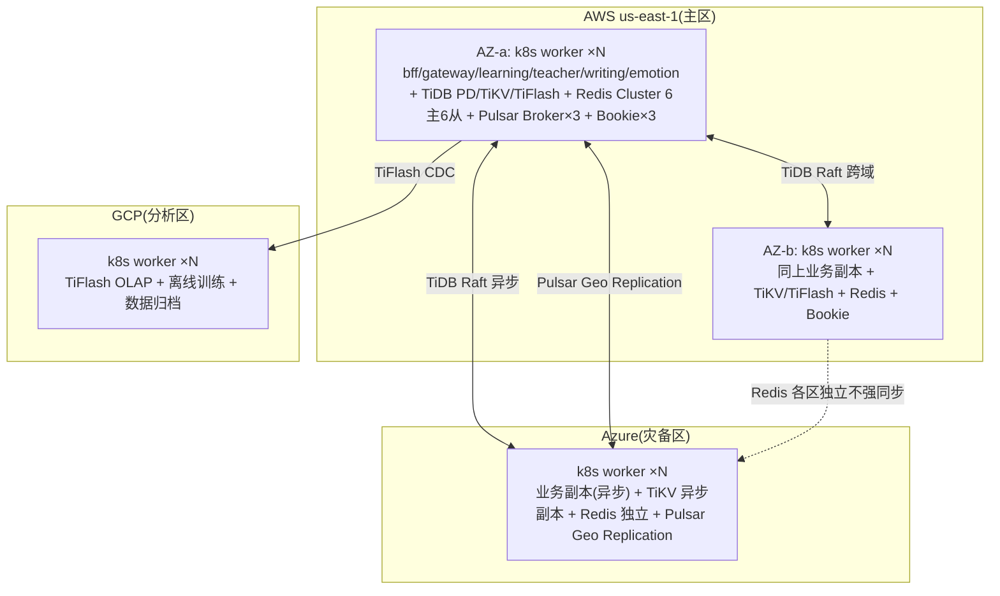

# D1 — 多节点目标拓扑(D2 Capacity Plan + D3 SLA/SLO 矩阵合并)

> TOGAF ADM Phase D(技术架构)P0 补救产出物(D1/D2/D3 合并)。
> 评估视角:教授级高级工程师 / 互联网大厂资深架构师(10亿用户/100万并发工业级基线)。
> 数据来源:SAD §2.3/§11 + `多区域数据同步方案.md` + `pulsar-geo-replication-plan.md` + `redis-cluster-migration-plan.md` + 5000 CCU 实压测(533 rps/P95 25s/7.3% 失败,单节点上限)。
> 日期:2026-08-13。

## 目的

补齐"单节点 → 多节点生产拓扑 + 5000 CCU 容量规划 + per 组件 SLA/SLO 矩阵",回答大厂架构师三问:瓶颈在哪、容灾怎么做、扩缩容路径。单节点为验证拓扑,本文件给出可移植的多节点目标态。

---

## 1. D1 多节点目标拓扑(3 地域 × 多 AZ)

**拓扑关键决策**:
- **TiDB PD 跨域 Raft**:PD leader 在主区,3 PD 跨 3 AZ;TiKV 3 副本跨 AZ(主区 2 + 灾备 1,RPO 0 强一致);TiFlash 异步到分析区。
- **Redis Cluster 各区独立不强同步**(ADR-redis-cluster-migration):主区 6 主 6 从,灾备区独立 Cluster,跨区不复制(避免双写不一致),灾备区靠业务重放或缓存重建。
- **Pulsar Geo Replication**:主区→灾备区异步复制(跨地域延迟可接受,消息最终一致)。
- **k8s 多 worker**:业务 deploy 跨 AZ 反亲和(antiAffinity),PDB minAvailable=1 保证滚动升级可用。
- **Ingress/网关**:主区 Traefik + WAF(OWASP/限速/bot 防护),灾备区 DNS 切换(Health Check 驱动)。

## 2. D2 容量规划(5000 CCU 目标)

> 单节点实压 533 rps/P95 25s/7.3% 失败,需多节点达标。以下为工业级基线估算。

| 层 | 组件 | 节点数 | 单节点规格 | HPA min/max | PDB | 扩缩容阈值 | 依据 |
|---|---|---|---|---|---|---|---|
| 接入层 | bff-java | 3(跨 AZ) | 4C8G | 2/10 | minAvail 1 | CPU 70% | RS256 验签 CPU 密集 |
| | gateway-go(WS) | 3 | 4C8G | 2/10 | minAvail 1 | WS 连接数 70% | 长连接,内存敏感 |
| 业务面Java | learning-java | 4 | 4C8G | 2/12 | minAvail 1 | CPU 65% + 队列深度 | Disruptor + Dubbo |
| | teacher-java | 3 | 4C8G | 2/8 | minAvail 1 | CPU 70% | Seata→Saga |
| Python AI | writing-py | 4 | 4C8G | 2/10 | minAvail 1 | LLM 队列深度 | LLM 长尾,需 surge |
| | emotion-svc | 2 | 2C4G | 1/5 | minAvail 1 | CPU 70% | — |
| | writing-coach | 3 | 2C4G | 1/6 | minAvail 1 | CPU 70% | — |
| Rust 4 | assessment/llm-orch/media/pronunciation | 各 2 | 4C8G | 1/4 | minAvail 1 | CPU 70% | P1(可低优先级) |
| Go 7 | course-path/listening/reading/vocab/gamification/live-tutor | 各 2 | 2C4G | 1/4 | minAvail 1 | CPU 70% | 轻量 |
| Worker | learning-worker | 3 | 4C8G | 1/8 | minAvail 1 | Pulsar lag | Disruptor/Pulsar 消费 |
| 前端 | frontend-react/h5 | 2 | 1C2G | 1/3 | minAvail 1 | 带宽 | 纯静态 nginx |
| 数据层 | TiDB PD | 3(跨 AZ) | 2C4G | — | — | — | Raft |
| | TiKV | 3+(主2灾1) | 8C32G + NVMe | — | — | — | region 压力是坑㉑根因 |
| | TiFlash | 2 | 8C32G | — | — | — | OLAP |
| 缓存 | Redis Cluster | 6主6从 | 4C16G | — | — | — | 各区独立 |
| 消息 | Pulsar Broker | 3 | 4C16G | — | — | — | Geo Replication |
| | Bookie | 3 | 4C32G + NVMe | — | — | — | bk-2 cookie 坑已修 |
| 可观测 | OTel Collector DS+GW | DS 每 worker + GW 2 | 1C2G | — | — | — | 双层 P2-4 |
| | Tempo/Loki/Prom/Grafana/AM | 各 2 | 4C16G | — | — | — | — |

**单节点 → 多节点切换标准**(同 E1 过渡架构):
1. 单节点验证拓扑全绿(本批 09 人工测 + 18 P0 scale 恢复全 1/1)。
2. 多节点集群就绪(k8s 多 worker + 跨 AZ 反亲和 + PDB)。
3. 数据层迁移:TiDB 加节点 PD rebalance;Redis 各区独立建 Cluster;Pulsar Geo Replication 启用。
4. 业务灰度:按批次 1-7(optimization-plan §二)scale,每批 healthz 验证 + 内存 headroom ≥20%。
5. 切流量:DNS/Ingress 灰度 10%→50%→100%,监控 SLO。

## 3. D3 SLA/SLO 矩阵(per 组件 RPO/RTO/Availability)

| 组件 | Availability 目标 | RPO | RTO | 灾备方式 | 监控指标 | 告警阈值 |
|---|---|---|---|---|---|---|
| TiDB | 99.95% | 0(强一致 Raft) | 5min(PD leader 切换) | 跨 AZ Raft 3 副本 | region 数/lag/QPS/P95 | region unavailable 9005(坑㉑)→ P1 |
| Redis Cluster | 99.9% | 0(主从同步) | 1min(failover) | 各区独立不强同步 | cluster_state/slots/eviction | cluster_state:fail → CLUSTER MEET 自愈(坑) |
| Pulsar | 99.95% | <1s(Geo 异步) | 5min | Geo Replication | backlog/bk writable | bk down → cookie 修复 |
| k8s API | 99.9% | — | 5min | 多 master | apiserver P95 | etcd 健康 |
| ArgoCD | 99% | 0(GitOps) | 5min | 主从 | sync status/drift | drift → 自愈 |
| Prometheus | 99.5% | 15s(scrape) | 5min | 双副本 + Thanos | ingestion/eval | rule eval fail |
| 业务服务 P0 | 99.9% | 业务相关 | 5min(HPA+PDB) | 多副本跨 AZ | healthz/error rate | 5xx >1% → 告警 |
| WS 口语会话 | 99.5% | 0(会话态 Redis) | 30s(reconnect) | hub shard=8 跨 pod 广播 | 连接数/断线率 | 断线率 >5% |
| LLM 调用 | 99%(外部依赖) | — | 降级 Mock | Mock/real 双模 | latency/error/token | P95 >10s → 降级 |

**业务 SLO 追溯**(对接 00-测试总览 §2):
- G-01 5000 CCU 在线:多节点达标(单节点 533 rps 不可达,如实)。
- G-02 口语引导 P95<800ms:多节点 + WS 分片达标。
- G-04 写作 ≥50rps P95<2s:多节点 + LLM surge 达标(单节点 47rps 接近,P95 73s 远超)。
- G-06 学情 ≥5000 ev/s:多节点 + Disruptor/worker 拆分达标(单节点 277 ev/s)。

## 4. DR(灾备)Runbook 要点(回写 D4,P1)

- **region 切换演练**:主区注入故障 → DNS 切灾备区 → 业务验证 → 回切。
- **健康判断**:每业务 healthz + 关键链路 L2 REST 冒烟 + DB 读写验证。
- **回切**:主区恢复 → 反向 Pulsar Geo + TiDB 反向 Raft → 灰度回切。
- **数据一致性校验**:TiDB checksum + Redis key 对比 + Pulsar backlog 清零。

## 出口条件

多节点拓扑图齐(3 地域 × 多 AZ);Capacity 表(5000 CCU 节点数/规格/HPA/PDB/阈值)齐;SLO 表(per 组件 RPO/RTO/Avail)齐;单节点→多节点切换标准 + DR Runbook 要点齐(已满足)。
