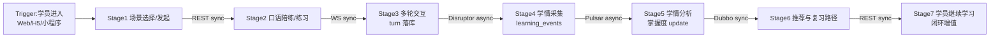
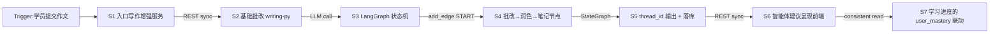

# B2 — 价值流图(3 条核心价值流)

> TOGAF ADM Phase B(业务架构)P0 补救产出物。
> 评估视角:教授级高级工程师 / 互联网大厂资深架构师。
> 数据来源:SRS §4 用例 + SDD 各服务章端到端流程注释 + ADR-01 Disruptor / ADR-langgraph / ADR-Seata→Saga。
> 日期:2026-08-13。

## 目的

用例替代不了价值流(价值流是 stage→trigger→entry→exit→stakeholder→value 增量结构)。本文档画 3 条核心价值流,验证端到端价值闭环,并为应用-数据矩阵(C1)与连调测点(L1-L10)提供业务语境。

---

## 价值流 1:学员一次完整学习闭环(自适应学习)

| Stage | trigger | 入口 | 产出 | 执行者 | value 增量 | 通信类型 | 数据表 |
|---|---|---|---|---|---|---|---|
| S1 场景选择 | 学员进入应用 | 前端 GET /api/scenarios | 场景列表(走 Redis Cluster 缓存) | frontend → gateway-go | 决策上下文就绪 | REST sync | scenarios |
| S2 发起会话 | 选场景 | POST /api/sessions | session_id | gateway-go | 会话上下文建立 | REST sync | sessions |
| S3 口语多轮交互 | 开始 | WS /ws/speech | 双工 ASR→LLM→TTS + Avatar | gateway-go(hub shard=8) | 实时纠错与反馈,语言输出 | WS sync | session_turns |
| S4 学情采集 | 每 turn 结束 | Disruptor publish | 事件入 RingBuffer | learning-java | 学情留存,无业务阻塞 | Disruptor async(内存) | — |
| S5 落库与分析 | RingBuffer drain | learning-worker 消费 | learning_events 落库 + user_mastery 更新 | learning-worker | 学情持久化与掌握度更新 | Disruptor/Pulsar async | learning_events, user_mastery |
| S6 推荐与复习 | 下次进入 | GET /api/learning/mastery/weak | 薄弱点 + dueReview + 推荐路径 | learning-java(consistent=true 强主库) | 个性化下一跳 | Dubbo Triple sync | user_mastery |
| S7 闭环增值 | 学员继续 | course-path-go / 练习业态 | 路径 + 连续学习 streak | course-path / listening / reading / vocab / gamification | 行为黏性 + 留存 | REST sync | user_streaks, achievements |

**关联利益相关者**:学员 S-1(主)、SRE S-5(可观测/弹性)、财务 S-6(token 成本)。
**验收 KPI**:5000 CCU 在线(P95<2s 写作、P95<800ms 口语引导)、薄弱点准确、D7/D30 留存。

---

## 价值流 2:一次写作批改批量闭环(LangGraph agent)

| Stage | trigger | 入口 | 产出 | 执行者 | value 增量 | 通信类型 | 数据表 |
|---|---|---|---|---|---|---|---|
| S1 入口 | 学员提交作文 | POST /api/writing-coach/... | 请求分发 | writing-coach | 单一入口,降耦合 | REST sync | — |
| S2 基础批改 | writing-coach 调下游 | POST /api/writing/grade | 评分 | writing-py | 即时反馈基线 | REST sync | writing_tasks, writing_essays |
| S3 LangGraph 状态机 | 进入 agent | StateGraph 节点编排 | 状态 thread_id | writing-py(langgraph 1.2.10) | 多步推理上下文 | 内部 sync | writing_plans |
| S4 节点执行 | add_edge(START,…) | 批改→润色→笔记 | 节点串行产出 | writing-py | 智能体结构化产出 | 内部 sync | writing_progress |
| S5 输出落库 | 状态终结 | thread_id + notes | 最终笔记落库 | writing-py | 可复用的改进笔记 | REST sync 返回 | writing_progress, writing_tasks |
| S6 前端呈现 | 笔记返回 | 前端展示 | 评分+建议 UI | frontend | 学员获益 | REST sync | — |
| S7 联动掌握度 | 评估反哺学情 | writing.graded→teacher.finalized→learning.user_mastery 透传 | user_id 端到端落库 | writing-py → learning-java | 闭环入学习主链 | 缓存 key 透传 + Dubbo async | user_mastery |

**关联利益相关者**:学员 S-1(主)、教师 S-2(批改辅助参照)、SRE S-5(LLM 长尾监控)。
**关联 ADR**:ADR-langgraph 1.x(0.2→1.x 迁移)、ADR-writing-coach。
**验收 KPI**:写作 ≥50 rps P95<2s(G-04);user_id 端到端落库验证通过(已落地,1.3.1 修复 esp-db-py read_timeout)。

---

## 价值流 3:一次教师教研闭环(教案 + 学情 + 作业评阅)

```mermaid
flowchart LR
    A[Trigger:教师进入教研] --> B[S1 输入主题]
    B -->|REST sync| C[S2 教案生成 lesson_plan]
    C -->|Dubbo sync| D[S3 班级学情汇总]
    D -->|Dubbo Triple| E[S4 Top-N 难题 + 薄弱点]
    E -->|REST sync| F[S5 作业评阅]
    F -->|Seata/Saga| G[S6 AI 自动分 + 教师终审]
    G -->|DB write| H[S7 终审落库 + 反哺学情]
```

| Stage | trigger | 入口 | 产出 | 执行者 | value 增量 | 通信类型 | 数据表 |
|---|---|---|---|---|---|---|---|
| S1 教师输入 | 教师进教研页 | 前端 POST /api/teacher/lesson | 主题+班级参数 | frontend(教师端) | 教研意图 | REST sync | — |
| S2 教案生成 | teacher-java 接收 | LLM/模板生成 | 结构化教案 | teacher-java | 教研效率提升 | REST sync(LLM) | lesson_plans |
| S3 班级学情汇总 | 教师查班级 | GET /api/teacher/class/:id | 班级学情概览 | teacher-java | 复杂班级洞察 | Dubbo Triple sync | classes |
| S4 Top-N 难题 | 跨服务调学习 | teacher→learning mastery 查询 | Top-N 难题 + 薄弱点 | teacher-java ⇒ learning-java(Dubbo Triple) | 聚焦教学重点 | Dubbo Triple sync | user_mastery, learning_events |
| S5 作业评阅 | 教师批改作业 | 批量评阅入口 | 评分草稿 | teacher-java | 评阅效率 | REST sync | assignments, submissions |
| S6 AI 自动分 + 教师终审 | 双轨评阅 | AI 自动分 → 教师终审确认 | 终审一致 | teacher-java | AI 辅助 + 教师主导权(不吃饭碗) | Seata/Saga 跨服务事务(ADR-Seata→Saga) | submissions |
| S7 终审落库反哺 | 终审完成 | DB write | 终审数据 + 学情反哺 | teacher-java | 闭环教学数据 | DB write + Pulsar async | submissions, user_mastery |

**关联利益相关者**:教师 S-2(主)、学员 S-1(受益)、SRE S-5(Dubbo 超时、Seata 全局锁)。
**关联 ADR**:ADR-Seata→Saga(teacher 学情汇总从 Seata AT 迁移到应用层 Saga 补偿)、ADR-new-services。
**验收 KPI**:教案生成时延;AI 与教师评分吻合度(终审率);Dubbo Triple 调用稳定(INT-2 超时 3s→10s)。

---

## 三价值流小结

| 价值流 | 横跨能力 | 横跨服务 | 通信类型多样性 | 关键风险 |
|---|---|---|---|---|
| 1 学习闭环 | 口语陪练 + 自适应学习 | gateway→learning→worker→course-path | REST/WS/Disruptor/Pulsar/Dubbo | LLM 长尾 + 单节点瓶颈 |
| 2 写作批改 | 写作批改 + 自适应联动 | writing-coach→writing-py→learning | REST/LLM/缓存透传/Dubbo | langgraph breaking change + LLM 长尾 |
| 3 教研闭环 | 教师教研 + 自适应学习 + 写作聚合 | frontend→teacher→learning | REST/Dubbo Triple/Seata→Saga | Dubbo 超时 + 全局锁 |

**三流共同横切**:接入鉴权(BFF/gateway RS256)、可观测(traceId 贯通)、缓存 key 三端契约统一、读写分离(follower lag 防读后写)。

## 出口条件

3 条价值流图齐(已满足),与 SRS §4 UC 对应;每 stage 标注通信类型(REST/Dubbo/Pulsar/WS/Disruptor);关联利益相关者与 KPI 已标。
