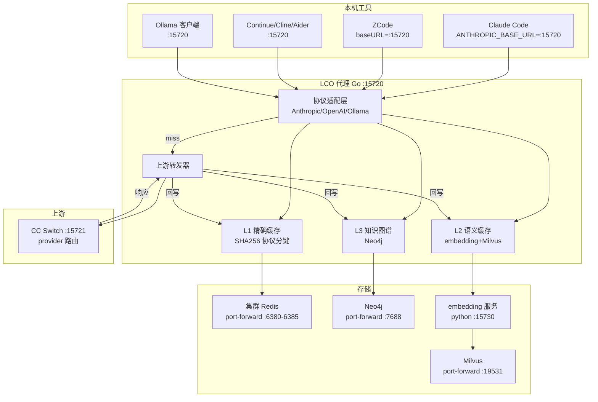
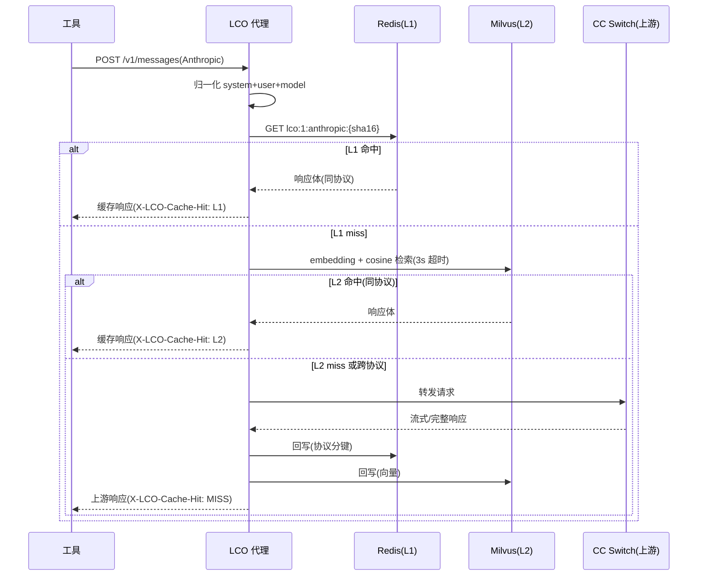

# LCO 代理软件设计文档(SDD)

> 状态:实现中(Phase 1 MVP)
> 作者:ESP 平台
> 日期:2026-08-19
> 关联铁律:LCO(LLM 调用缓存优化)、CLC(代码级正确性)、ASV(API 签名核实)、MPB(零 mock)

## 1. 概述

### 1.1 背景

LCO 代理(`tools/lco-proxy/`)是 LLM 多级缓存铁律(LCO)的**工具侧落地**。ESP 平台内的 LLM 服务(conversation-go / orchestrator-rs / writing-coach)已按 LCO 铁律接了三层缓存,但**本机编码工具**(Claude Code、ZCode、Continue、Cline、Aider、Ollama 客户端)的 LLM 调用**绕过缓存层裸调**,违反 LCO 铁律。

LCO 代理在工具与上游 LLM 之间插入透明缓存层,让本机工具的 LLM 调用同样享受三层语义缓存。

### 1.2 目标

- **L1 精确缓存**:同协议同 prompt 命中,省 100% API 调用
- **L2 语义缓存**:跨协议语义相似命中,省 80-95%
- **L3 知识图谱**:prompt→response 关系沉淀(上下文增强)
- **多工具接入**:Anthropic / OpenAI / Ollama 三协议透明适配
- **降级安全**:任一缓存层不可达不阻断,直穿上游

### 1.3 范围

**范围内**:L1 Redis 精确缓存、L2 Milvus 语义缓存、L3 Neo4j 图谱、三协议适配、launchd 自愈、Prometheus 监控。

**范围外(DEFERRED)**:L2 跨协议重生成(需 LLM 二次调用)、L3 实际 Cypher 写入(需 schema 设计)、多节点迁移(需 ClusterClient + 真实 CIDR)、GitHub Copilot/Cursor 接入(无自定义 endpoint 入口)。

## 2. 架构设计

### 2.1 总体架构



### 2.2 缓存查询流程



## 3. 组件设计

| 组件 | 路径 | 职责 |
|---|---|---|
| 入口 | `cmd/lco-proxy/main.go` | 启动 HTTP 服务 + 优雅关闭 |
| 配置 | `internal/config/config.go` | env 加载,零硬编码 |
| 协议 | `internal/protocol/protocol.go` | 三协议归一化(提取 system/user/model) |
| 缓存管理 | `internal/cache/manager.go` | L1/L2/L3 编排 + 降级 |
| L2 语义 | `internal/cache/l2.go` | embedding + Milvus 检索/插入 |
| L3 图谱 | `internal/cache/l3.go` | Neo4j 记录(DEFERRED) |
| HTTP | `internal/server/server.go` | 三端点 + 缓存拦截 + 上游转发 |
| embedding | `embedding/app.py` | 多模型 + 语言路由 + MPS |

### 3.1 协议归一化接口

```go
type NormalizeKey struct {
    Protocol Protocol // anthropic/openai/ollama
    Model    string
    System   string
    User     string
    Raw      string // SHA 输入 + 向量输入
}

func Normalize(path string, body []byte) (NormalizeKey, error)
```

## 4. 数据设计

### 4.1 Redis(L1)key schema

```
lco:1:{protocol}:{sha256前16位}
  protocol: anthropic | openai | ollama
  TTL 分级: chat=3600s, code=86400s, knowledge=604800s
```

### 4.2 Milvus(L2)collection schema

> 宿主 LCO 代理用 port-forward 的 Milvus(`lco_prompts`,2560维 Qwen);
> **ESP 服务侧(三服务共用)`esp_llm_semantic`,384维 minilm**(跨服务语义缓存共享)。
> 两者独立 collection —— 宿主侧为工具缓存(中文为主 Qwen),服务侧为运行时缓存(英文代码为主 minilm,维度稳定)。

```
宿主 LCO collection: lco_prompts
  vector: FloatVector(2560 维, Qwen3-Embedding-4B)
  body:    VarChar(响应体)
  protocol: VarChar(源协议)
  model:   VarChar
  ts:      Int64
  index: HNSW, metric=cosine

ESP 服务侧 collection: esp_llm_semantic(三服务共用)
  prompt_sha16: VarChar(主键)
  response:    VarChar(缓存的 LLM 回复)
  model:       VarChar
  scene:       VarChar(chat/code/knowledge)
  ts:          Int64
  embedding:   FloatVector(384 维, all-MiniLM-L6-v2)
  index: HNSW, metric=cosine, 阈值 0.92
```

### 4.3 Neo4j(L3)图模型

```
(Prompt)-[:ANSWERED]->(Response)
(Prompt)-[:USES]->(Model)
(Prompt)-[:BELONGS_TO]->(Protocol)
constraint: Prompt.sha16 UNIQUE
```

> L3 在宿主 LCO 代理侧 DEFERRED;ESP 服务侧 Phase3 由三服务(conversation-go/writing-coach/orchestrator-rs)落地,共用同一 Neo4j 实例。

### 4.4 embedding 模型

| 模型 | 维度 | 语言 | 场景 |
|---|---|---|---|
| Qwen3-Embedding-4B | 2560 | 中文/多语言 | 中文 prompt |
| all-MiniLM-L6-v2 | 384 | 英文 | 英文 prompt |

## 5. 部署设计

### 5.1 宿主部署(当前)

- LCO 代理:宿主 Go 进程 `:15720`
- embedding:宿主 python venv `:15730`(MPS 加速)
- port-forward 三通道(launchd 自愈):
  - redis-cluster-new 6 pod → `:6380-6385`
  - milvus → `:19531`
  - neo4j → `:7688`

### 5.2 配置项

| env | 默认 | 说明 |
|---|---|---|
| LCO_LISTEN | 127.0.0.1:15720 | 监听地址 |
| LCO_UPSTREAM_URL | http://127.0.0.1:15721 | 上游(CC Switch) |
| LCO_REDIS_ADDR | 127.0.0.1:6380 | L1 Redis(逗号分隔多节点) |
| LCO_EMBEDDING_URL | http://127.0.0.1:15730/embed | embedding 服务 |
| LCO_MILVUS_ADDR | 127.0.0.1:19531 | Milvus |
| LCO_NEO4J_URL | bolt://127.0.0.1:7688 | Neo4j |
| LCO_L2_THRESHOLD | 0.92 | cosine 阈值 |
| LCO_CACHE_ENABLED | true | 缓存开关 |

### 5.3 多节点迁移路径(DEFERRED)

单节点 port-forward 是验证拓扑。多节点迁移时:Redis 改 ClusterClient + 真实 pod CIDR;Milvus/Neo4j 改 ClusterIP 直连;embedding 服务迁入集群(届时资源充足)。

## 6. 安全与治理

### 6.1 鉴权

LCO 代理**不校验上游 key**,原样透传 `x-api-key`/`Authorization`/`anthropic-version` 头。LCO 只做缓存拦截,不做身份校验。密钥不落 LCO 配置(透传自工具)。

### 6.2 缓存穿透防护

- 非 200 响应不缓存(避免缓存错误)
- 流式响应(SSE)不缓存(无法完整捕获)
- L1 key 协议分键,避免跨协议响应串台
- 缓存不可达降级直穿,不阻断

### 6.3 审计日志

结构化 JSON 日志(slog):缓存命中层、协议、上游 URL、错误。Prometheus 指标:llm_cache_hits_total{layer}、llm_cache_misses_total{layer}。

## 7. 已知限制与后续工作

| 项 | 状态 | 说明 |
|---|---|---|
| L2 跨协议重生成 | ⏳ DEFERRED | 需 LLM 二次调用,成本权衡 |
| L3 Neo4j 实际写入 | ⏳ DEFERRED | 需 schema 设计 + Cypher |
| Redis Cluster MOVED | ⚠️ 降级 | 单节点 Client,MOVED 降级直穿 |
| 测试覆盖 | ⚠️ 24.5% | cache 集成测试需 miniredis 补齐 |
| CI | ✅ | .github/workflows/lco-proxy-ci.yml |
| Dockerfile | ✅ | 多阶段构建 |
