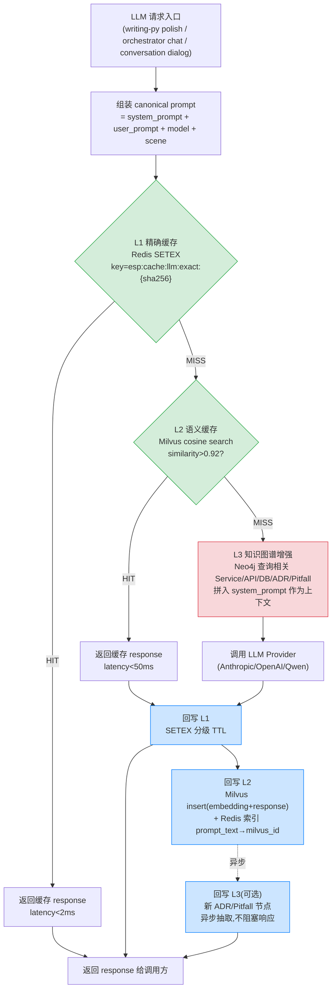

# LLM 调用三层缓存架构设计

> **状态**:设计稿(待评审) | **日期**:2026-08-18 | **作者**:架构组
> **关联**:`docs/design/多级缓存架构对齐.md`(业务实体缓存)、`docs/design/architecture/engineering-ironrules.md`(工程铁律)
> **只读勘测基线**:Redis Cluster / Milvus / Neo4j 均已部署且 esp-prod 有 ExternalName 短名可达;**未做任何 scale/改 deploy**。

---

## 0. 背景与现状勘误(先纠偏,再设计)

用户原始 brief 假设"每次调用大模型无缓存"。**只读勘测三个 LLM 服务后发现:三层缓存的 L1(精确)已部分存在**,直接新建并行缓存会导致命中分散(两套 key 各存一份,命中率被对半切)。本设计的核心原则是 **收敛复用 + 分层补齐**,而非推倒重来。

### 0.1 现有 LLM 缓存资产盘点

| 服务 | 框架(勘误) | 已有 L1 精确 | 已有 L2 近似 | 接入点(实际) |
|---|---|---|---|---|
| writing-py | **Litestar**(非 FastAPI) | `esp_cache.get_or_load`(cachetools LRU + L2 redis) | `LLMCache`(redis.asyncio, key `llm:cache:{sha256}`, TTL 3600s) | `app/llm.py:203` `AnthropicLlmProvider.chat`(system+user 此处成型) |
| llm-orchestrator-rs | **axum**(非 actix) | `cache::get`/`set`(key `esp:llm:cache:{sha256(prompt\|model\|scene)}`, SETEX) | `esp:llm:sem:{scene}:{model}` ZSET **SimHash**(占位符,Cargo.toml 注释明示待替换) | `src/cache/mod.rs`(handler `llm_chat` 内联调用) |
| conversation-go | Go net/http | `src/cache/cache.go` L1(map+链表)+ L2 redis-cluster(`GetOrLoad`) | 无 | `llm.Provider` 接口(`llm/anthropic.go:38 Chat`),`dialog.Engine.LLM` 注入 |

**结论**:L1 精确缓存三服务都已落地(实现不一),L2 近似仅 llm-orchestrator-rs 有且是 SimHash 占位,L3 知识图谱三服务均无。本设计 = **统一 L1 key 规范 + 替换 L2 SimHash→Milvus 向量 + 新建 L3 Neo4j 图**。

### 0.2 基础设施现状(只读,勿动)

| 组件 | 版本 | Pod 数 | 年龄 | esp-prod 短名 | 端口 | ESP 已接入? |
|---|---|---|---|---|---|---|
| Redis Cluster | (sts redis-cluster-new) | 6(勘测时 0/1 ready) | 14d | `redis-cluster` | 6379 | 是(三服务 L1 已用) |
| Milvus | v2.5.0 standalone | 1 | 127d | `milvus` | 19530(gRPC)/9091(metrics) | **否**(休眠,无服务代码引用) |
| Neo4j | 5.25.1 community | 1 | 128d | `neo4j` | 7687(Bolt)/7474(HTTP) | **否**(休眠) |
| Milvus-minio | RELEASE.2024-05-28 | 1 | 127d | (内部) | 9000/9001 | Milvus 后端 |

- ExternalName 定义文件:`deploy/k8s/05b-platform-infra-externalnames.yaml`,短名 `milvus`/`neo4j` 经 `platform-infra` ns 中转指向 `ekb-m2-aws-us-east-1`。
- **风险提示(Phase 1 前置)**:`redis-cluster-new-0..5` 勘测时全部 `0/1 Running`(readiness probe failing),旧 `redis-cluster` ClusterIP 仍可解析。L1 依赖 Redis,Phase 1 启动前必须确认 Redis Cluster 健康度(`kubectl -n ekb-m2-aws-us-east-1 get pods -l app=redis-cluster-new` 全部 1/1),否则 L1 降级为进程内 LRU 兜底(各服务已具备降级逻辑)。

---

## 1. 三层缓存架构总览

### 1.1 设计目标

1. **降本**:重复/相似 prompt 命中缓存,省 API 额度(目标:对话场景命中率 ≥ 30%,知识查询 ≥ 60%)。
2. **降延迟**:L1 命中 < 2ms(Redis),L2 命中 < 50ms(Milvus),对比 LLM 调用 800ms~5s。
3. **上下文增强**:L3 Neo4j 替代文件搜索,给 LLM 注入代码关系/ADR/坑记录,提升回答质量(非缓存命中,是 RAG 上下文)。
4. **收敛**:统一三服务分散的 L1 实现,避免命中分散。

### 1.2 数据流(mermaid 自包含)



**关键路径说明**:
- L1 HIT → 直接返回(不触发 L2/L3)。
- L1 MISS → L2 语义查;L2 HIT → 回写 L1(填充精确层)→ 返回。
- L1+L2 MISS → L3 知识图谱增强(拼上下文,非缓存命中)→ LLM 调用 → 回写 L1+L2 → 异步回写 L3。
- L3 始终是 **miss path 的上下文增强**,不是缓存层;图独立成层是因为它既被 miss path 读、也被 miss path 异步写。

### 1.3 三层职责边界

| 层 | 职责 | 存储 | 命中语义 | 失败降级 |
|---|---|---|---|---|
| **L1 精确** | 字节级一致 prompt 的响应缓存 | Redis Cluster | sha256 全等 | Redis 不可用 → 进程内 LRU(已具备) |
| **L2 语义** | 语义相似 prompt 的响应缓存 | Milvus(向量)+ Redis(prompt_text→id 索引) | cosine > 0.92 | Milvus 不可用 → 跳过直查 L3 |
| **L3 知识图谱** | 代码关系/ADR/坑的上下文注入(**非缓存**) | Neo4j | 不命中概念,是查询增强 | Neo4j 不可用 → 跳过,走原始 prompt |

**边界铁律**:L3 不缓存 response(知识图谱是事实,不是 LLM 输出);L2 只缓存 response 不存上下文(L3 增强的上下文每次实时查,避免脏读)。

---

## 2. 命中策略

### 2.1 L1 精确命中

- **key**:`esp:cache:llm:exact:{sha256(canonical_prompt)}`,`canonical_prompt = normalize(system_prompt + "\n---\n" + user_prompt + "\n" + model + "\n" + scene)`。
- **normalize**:去首尾空白、统一换行 `\n`、折叠连续空格。**不做**大小写折叠(代码 prompt 大小写敏感)。
- **命中**:`GET key` → 反序列化 JSON `{response, model_version, created_at, ttl_category}` → 校验 `model_version` 一致 → 返回。
- **分级 TTL**(按 `scene` 字段路由,scene 由调用方传入或从 endpoint 推断):

| scene | TTL | 理由 |
|---|---|---|
| `conversation`(对话) | 1h | 对话上下文滚动,旧 response 可能不再适用 |
| `code_generation`(代码生成) | 24h | 代码 prompt 同质化高,但模型迭代快 |
| `knowledge_query`(知识查询) | 7d | 事实型 prompt 稳定 |
| `writing_polish`(润色) | 6h | 学生作文同质,但学期内可能重做 |
| 默认 | 1h | 保守 |

- **LRU 淘汰**:Redis Cluster 用 `maxmemory-policy allkeys-lru`(若未配,Phase 1 落地时在 deploy 配置层加,不改现有 redis-cluster deploy——通过新建独立的 `llm-cache` 逻辑 DB 或靠 key TTL 自然淘汰;单节点验证期靠 TTL)。

### 2.2 L2 语义命中

- **embedding 模型**:固定 `all-MiniLM-L6-v2`(384 维,离线,`sentence-transformers`)。conversation-go `semantic.go:44` 固定 `l2EmbeddingModel="minilm"`,orchestrator-rs `mod.rs:147` 显式传 `model=minilm`,共用 collection `esp_llm_semantic`(384 维,cosine≥0.92)。**(2026-08-20 修正:原文写 `text-embedding-3-small`/1536 维 + bge 兜底,是早期选型草案;实际落地统一 minilm 384 维,避免 zh/en 维度不一致 + 离线零外部依赖。见 §6.2 实际 schema。)**
- **查询**:`user_prompt`(不含 system_prompt,因 system 多为模板硬编码,会稀释语义)→ embed → Milvus `search(top_k=1, metric="COSINE", params={"radius":0.92})`。
- **命中校验**:cosine > 0.92 且 `model_version` 一致且 `created_at` 未过 TTL(L2 不设独立 TTL,靠 L1 TTL 兜底;L1 过期后即使 L2 命中也不返回,强制刷新)。
- **防污染**:L2 只缓存 `knowledge_query`/`writing_polish` 场景;`conversation` 场景 **不写 L2**(对话上下文强依赖历史,相似 prompt 可能需不同回答)。

### 2.3 L3 上下文增强(非命中)

- **触发**:L1+L2 MISS 时,从 `canonical_prompt` 抽取实体(服务名/API 路径/表名/技术名词)→ Neo4j Cypher 查询 2 跳邻居 → 拼成 context block 注入 system_prompt。
- **查询示例**:`MATCH (s:Service)-[:calls]->(a:API)-[:reads]->(t:DBTable) WHERE s.name IN $entities RETURN s,a,t LIMIT 20`。
- **不缓存**:L3 查询结果每次实时查(知识图谱变更需即时反映,如新加 ADR)。

---

## 3. 技术选型对比

| 维度 | 自研中间件 | LangCache(Scaleway) | GPTCache | Redis Semantic Cache(RedisAI) |
|---|---|---|---|---|
| 向量后端 | Milvus(已有) | 托管(不可控) | 本地 SQLite/FAISS | Redis 模块(需 RedisAI) |
| 精确层 | Redis(已有) | 内置 | 内置 dict | Redis(已有) |
| 知识图谱 | Neo4j(已有) | 无 | 无 | 无 |
| 多语言 SDK | Go/Python/Rust 全控 | Python 为主 | Python 为主 | Python 为主 |
| ESP 单节点适配 | 完全可控,复用现有 Milvus/Neo4j/Redis | 引入外部依赖,不可移植多节点 | 单机 FAISS 无法跨 pod 共享 | 需装 RedisAI 模块(动共享 Redis,违反只读铁律) |
| L3 上下文增强 | 原生 Neo4j | 不支持 | 不支持 | 不支持 |
| 改造成本 | 中(三服务各加 client) | 低(但锁定 Scaleway) | 中(Python only,Rust/Go 需自封装) | 高(动共享 Redis) |

**选型结论:自研中间件 + 复用已有 Milvus/Neo4j/Redis Cluster**。

理由(对标用户工业级标尺):
1. **已有基础设施零增量**:Milvus 127d 稳定运行、Neo4j 128d、Redis Cluster 已是三服务 L1 底座,引入 LangCache/GPTCache/RedisAI 均需新增外部依赖或动共享 Redis(违反 `esp-shared-infra-ironrule` 租户隔离红线)。
2. **三语言一致性**:ESP 是 Go/Java/Python/Rust 多语言微服务,自研中间件可按各语言原生 SDK 封装统一 client(Milvus 有 pymilvus/go-milvus/rust-milvus;Neo4j 有 neo4j-python-driver/neoistency/bolt-client),LangCache/GPTCache 仅 Python 友好。
3. **L3 不可替代**:知识图谱上下文增强是 ESP 特有需求(代码关系/ADR/坑),四个候选只有自研方案能接 Neo4j。
4. **多节点可移植**:自研 client 配置 ExternalName 短名(`milvus`/`neo4j`/`redis-cluster`),单节点验证后直接移植多节点,无需迁出托管服务。
5. **诚实权衡**:自研成本是中(三服务各加 client + embedding 调用),但 ESP 目标 5000 CCU 规模下,缓存中间件不是瓶颈,自研可控性 > 托管便利性。

---

## 4. 集成点(三服务最小改动伪代码)

> **勘误**:用户 brief 的"FastAPI middleware / actix middleware"前提在三服务均不成立。实际接入点经只读勘测确认如下。

### 4.1 writing-py(Litestar,接入点 = `AnthropicLlmProvider.chat`)

**为何不用 middleware**:writing-py 的 polish/grade/translate 共用 `AnthropicLlmProvider.chat`,且 `service.py` 已用 `esp_cache.get_or_load` 做 L1 LRU。middleware 层拦截会绕过 `get_or_load` 的进程内 L1,造成 L1+新缓存双写、命中分散。接入 `chat()` 使三层缓存在 system+user 成型处统一收口。

文件:`backend/services/writing-py/app/llm.py`(现有 `LLMCache` class at L78-132,`chat()` at L203-232)。

```python
# app/llm.py — AnthropicLlmProvider.chat 改造(收敛现有 LLMCache → 三层)
class AnthropicLlmProvider:
    async def chat(self, system: str, user: str, scene: str = "writing_polish") -> str:
        canonical = self._canonical(system, user, self.model, scene)
        l1_key = f"esp:cache:llm:exact:{sha256(canonical.encode()).hexdigest()}"

        # L1 精确(复用现有 redis.asyncio.RedisCluster 连接,替换旧 llm:cache: key)
        l1 = await self._redis.get(l1_key)
        if l1:
            metrics.inc("llm_cache_hits_total", layer="L1")
            return json.loads(l1)["response"]

        # L2 语义(user_prompt only,跳过 conversation 场景)
        if scene != "conversation":
            emb = await self._embed(user)  # text-embedding-3-small
            hit = await self._milvus.search(emb, model_version=self.model, top_k=1, min_sim=0.92)
            if hit:
                metrics.inc("llm_cache_hits_total", layer="L2")
                await self._redis.setex(l1_key, TTL_BY_SCENE[scene], json.dumps({"response": hit.response, ...}))
                return hit.response

        # L3 知识图谱增强(非缓存,拼上下文)
        ctx = await self._neo4j.enhance(canonical)  # 返回相关 Service/API/DB/ADR 文本块
        augmented_system = f"{system}\n\n[Context]\n{ctx}" if ctx else system

        # LLM 调用
        metrics.inc("llm_cache_misses_total")
        raw = await self._raw_call({"model": self.model, "max_tokens": 1024,
                                     "system": augmented_system,
                                     "messages": [{"role": "user", "content": user}]}, self._headers())

        # 回写 L1 + L2(异步)
        await self._redis.setex(l1_key, TTL_BY_SCENE[scene], json.dumps({"response": raw, "model_version": self.model, "created_at": now(), "ttl_category": scene}))
        if scene != "conversation":
            asyncio.create_task(self._milvus.insert(prompt_text=user, embedding=emb, response_text=raw, model_version=self.model, scene=scene))

        metrics.inc("llm_cost_saved_usd", amount=estimate_cost(raw))  # miss 时不计 saved,仅 L1/L2 命中时计
        return raw
```

**改动清单**:`llm.py` 加 `_embed`/`_milvus`/`_neo4j` client(Phase2/3);`LLMCache` class 收敛为新 `L1Cache` 命名;`pyproject.toml` 加 `pymilvus`/`neo4j`(Phase2/3)。Phase 1 仅改 L1 key 前缀 `llm:cache:` → `esp:cache:llm:exact:` + 分级 TTL。

### 4.2 llm-orchestrator-rs(axum,接入点 = `cache/mod.rs`)

**为何不用 middleware**:axum middleware 在 `llm_chat`(main.rs:239)外层,但现有 `cache::get`/`cache::set` 已在 handler 内联且已是 L1+L2(SimHash),最省改动是替换 `cache/mod.rs` 内部实现,middleware 无需新增。

文件:`backend/services/llm-orchestrator-rs/src/cache/mod.rs`(现有 L1 SETEX + L2 SimHash ZSET)。

```rust
// src/cache/mod.rs — 改造(替换 SimHash L2 → Milvus 向量;L1 key 前缀统一)
pub async fn get(state: &AppState, prompt: &str, model: &str, scene: &str) -> Option<String> {
    let canonical = canonical_prompt(prompt, model, scene);
    let l1_key = format!("esp:cache:llm:exact:{}", sha256(canonical.as_bytes()));

    // L1 精确(复用现有 redis ClusterConnection)
    if let Ok(Some(v)) = state.redis.get::<_, Option<String>>(&l1_key).await {
        metrics::counter!("llm_cache_hits_total", "layer" => "L1").increment(1);
        return Some(v);
    }

    // L2 语义(替换原 SimHash ZADD → Milvus cosine search)
    if scene != "conversation" {
        let emb = embed(state, prompt).await.ok()?;  // text-embedding-3-small
        if let Some(hit) = milvus_search(state, &emb, model, 0.92).await.ok()? {
            metrics::counter!("llm_cache_hits_total", "layer" => "L2").increment(1);
            let _ = state.redis.set_ex::<_, _, ()>(&l1_key, &hit.response, ttl_for_scene(scene)).await;
            return Some(hit.response);
        }
    }
    metrics::counter!("llm_cache_misses_total").increment(1);
    None
}

pub async fn set(state: &AppState, prompt: &str, model: &str, scene: &str, response: &str) {
    let canonical = canonical_prompt(prompt, model, scene);
    let l1_key = format!("esp:cache:llm:exact:{}", sha256(canonical.as_bytes()));
    let _ = state.redis.set_ex::<_, _, ()>(&l1_key, response, ttl_for_scene(scene)).await;
    if scene != "conversation" {
        if let Ok(emb) = embed(state, prompt).await {
            let _ = milvus_insert(state, prompt, &emb, response, model, scene).await;
        }
    }
    // L3 异步增强(Phase3)
}
```

`main.rs:311` `llm_chat` handler 现有调用 `cache::get` → `providers.call` → `cache::set` **无需改动**,透明升级。`Cargo.toml` 加 `milvus`/`neo4rs`(Phase2/3)。Phase 1 仅改 L1 key `esp:llm:cache:` → `esp:cache:llm:exact:` + 分级 TTL(按现有 `scene` 字段)。

### 4.3 conversation-go(接入点 = Provider 装饰器)

**为何是 provider 层装饰器**:`dialog.Engine.LLM` 是注入的 `llm.Provider` 接口,装饰器包装后 `Engine` 零改动,符合用户"provider 层包装"指导。

文件:新增 `backend/services/conversation-go/src/llm/cached.go`(装饰器);改 `llm.New()` 调用点注入。

```go
// src/llm/cached.go — 新增 CachedProvider 装饰器
type CachedProvider struct {
    inner llm.Provider          // 包装 AnthropicProvider / MockProvider
    redis *redis.ClusterClient  // 复用现有 src/cache/cache.go 的 client()
    milvus MilvusClient         // Phase2 注入
    neo4j  Neo4jClient          // Phase3 注入
    model  string
}

func (c *CachedProvider) Chat(ctx context.Context, messages []llm.Message) (string, error) {
    system, user := foldMessages(messages)  // 复用 anthropic.go 的 system 折叠逻辑
    canonical := canonicalPrompt(system, user, c.model, "conversation")
    l1Key := "esp:cache:llm:exact:" + sha256(canonical)

    // L1 精确
    if v, err := c.redis.Get(ctx, l1Key).Result(); err == nil {
        metrics.L1Hits.Inc()
        return v, nil
    }
    // conversation 场景跳过 L2(上下文强依赖历史)
    // L3 增强(Phase3)
    metrics.Misses.Inc()
    resp, err := c.inner.Chat(ctx, messages)  // 委托真实 Provider
    if err != nil { return "", err }
    _ = c.redis.Set(ctx, l1Key, resp, time.Hour).Err()  // conversation TTL 1h
    return resp, nil
}

// 注入点(原 llm.New() 调用处,如 app.go / main.go)
// before: provider := llm.New(cfg)
// after:  provider = llmcache.Wrap(llm.New(cfg), redisClient, model)
```

**改动清单**:新增 `src/llm/cached.go`;改 `llm.New()` 调用点包一层 `llmcache.Wrap(...)`;`dialog.Engine` 零改动。Phase 1 仅 L1 装饰器;Phase2/3 加 milvus/neo4j client 字段。`go.mod` 已有 `go-redis/v9`,Phase1 无新依赖。

---

## 5. 失效策略

| 失效场景 | 触发 | L1 | L2 | L3 |
|---|---|---|---|---|
| prompt 变化 | canonical hash 变 | 自动 MISS(新 key) | 旧 embedding 保留(语义可能仍命中,但 L1 MISS 后 L2 查新 embedding 自然不命中旧向量) | 不影响(L3 实时查) |
| 模型升级 | `model` 变 | `model_version` 校验不一致 → MISS;旧 key 设短 TTL 让其过期 | `model_version` filter 过滤旧模型记录 | 不影响 |
| 时间过期 | TTL 到期 | SETEX 自动过期 | 靠 L1 TTL 兜底(L1 过期不回 L2) | 不适用 |
| 主动失效 | ADR 变更/坑修复 | `DEL esp:cache:llm:exact:*`(SCAN+DEL) | Milvus `delete` by `model_version` 或时间窗 | Neo4j 节点更新(实时) |
| 缓存中毒 | 异常 response 被写 | `DEL key` + 告警 | `delete` by milvus_id + 告警 | 不影响 |

**模型升级铁律**:每次 `ANTHROPIC_MODEL`/`model` 配置变更,`model_version` 字段变化,L1/L2 命中校验自动失效。Phase 1 落地时 `model_version` 必须写入缓存 value(不是只靠 key hash,因 hash 含 model 但旧代码可能未含)。

---

## 6. Schema 设计

### 6.1 Redis key 命名规范

```
# L1 精确缓存(三服务统一)
esp:cache:llm:exact:{sha256(canonical_prompt)}   → JSON value, SETEX ttl_by_scene

# L2 Milvus ID 索引(prompt_text → milvus_id 反查,用于主动失效)
esp:cache:llm:sem:idx:{sha256(user_prompt)}       → milvus_id:String, SETEX 7d

# L3 无 Redis 存储(Neo4j 实时查)

# 元数据
esp:cache:llm:meta:stats:{service}:{scene}       → hash{hits,misses,cost_saved_usd}, INCRBY
```

**value JSON 结构**(L1):
```json
{
  "response": "...",
  "model_version": "claude-sonnet-4-6",
  "created_at": 1723891200,
  "ttl_category": "knowledge_query",
  "service": "writing-py"
}
```

**命名收敛**:writing-py 旧 key `llm:cache:{sha256}`、orchestrator 旧 key `esp:llm:cache:{sha256}` 统一为 `esp:cache:llm:exact:{sha256}`。迁移期(Phase1)双写新旧 key,读优先新 key fallback 旧 key,2 周后删旧 key。

### 6.2 Milvus collection schema

> **2026-08-20 修正**:以下是早期选型草案(`esp_llm_sem_cache`,dim=1536 text-embedding-3-small)。**实际落地与此不同**——业务 LCO 统一用 `all-MiniLM-L6-v2`(384 维),collection 名 `esp_llm_semantic`(conversation-go `semantic.go:44` + orchestrator-rs `mod.rs:147` 共用),字段 `prompt_sha16/response/model/scene/ts/embedding(384维)`。下方原草案保留作选型决策溯源,实现以 `llm-cache-proxy-sdd.md` §4.2 + 代码为准。

```python
# Collection: esp_llm_sem_cache  (草案,未落地;实际见上注 esp_llm_semantic/384维)
fields = [
    FieldSchema(name="id", dtype=DataType.VARCHAR, max_length=64, is_primary=True),  # ulid
    FieldSchema(name="prompt_text", dtype=DataType.VARCHAR, max_length=8192),
    FieldSchema(name="embedding", dtype=DataType.FLOAT_VECTOR, dim=1536),  # text-embedding-3-small
    FieldSchema(name="response_text", dtype=DataType.VARCHAR, max_length=16384),
    FieldSchema(name="created_at", dtype=DataType.INT64),  # unix ts
    FieldSchema(name="model_version", dtype=DataType.VARCHAR, max_length=64),
    FieldSchema(name="scene", dtype=DataType.VARCHAR, max_length=32),
    FieldSchema(name="service", dtype=DataType.VARCHAR, max_length=32),
]
# Index: IVF_FLAT or HNSW on embedding, metric_type="COSINE"
# Partition: by scene (knowledge_query / writing_polish / code_generation)
```

**注**:dim=1536(text-embedding-3-small);若用 bge-small-zh 则 dim=384,需建独立 collection 或统一用 1536(推荐统一 1536,本地兜底时 zero-pad 或用投影矩阵——Phase2 选型时定)。

> **实际落地(2026-08-20)**:业务统一 `esp_llm_semantic` 384 维 minilm(不分 zh/en,避免维度不一致),与宿主 llm-cache-proxy 的 `lco_prompts` 2560 维 Qwen 独立——两个 LCO 各自 collection 维度自洽,互不干扰。

### 6.3 Neo4j node/edge 模型

```cypher
// Nodes
(:Service {name, language, port, repo_path})
(:API {path, method, handler, service})
(:DBTable {name, db, columns})
(:Decision:ADR {id, title, status, date, context, decision})
(:Pitfall {id, title, root_cause, fix, date, severity})
(:TechStack {name, version, constraint})

// Edges
(:Service)-[:calls {endpoint}]->(:API)
(:API)-[:reads {columns}]->(:DBTable)
(:API)-[:writes {columns}]->(:DBTable)
(:Decision)-[:constrains]->(:Service)
(:Decision)-[:constrains]->(:TechStack)
(:Pitfall)-[:affects]->(:Service)
(:Pitfall)-[:affects]->(:TechStack)
(:Service)-[:depends_on]->(:TechStack)
(:Service)-[:depends_on]->(:Service)
```

**L3 查询示例**(miss path 上下文增强):
```cypher
// 从 prompt 抽取的实体 $entities(服务名/表名/API 路径)
MATCH (n)-[r*1..2]-(m)
WHERE n.name IN $entities AND labels(n)[0] IN ['Service','API','DBTable','Decision','Pitfall']
RETURN n, r, m LIMIT 30
```

**自动抽取源**(Phase3):`docs/design/adr-*.md`(ADR)、`CLAUDE.md` + memory `*-ironrule`(Pitfall)、`*.go`/`*.py`/`*.rs`/`*.java` 源码 AST(Service/API/DB)。抽取器按 md frontmatter + 代码注释 `// calls`/`# reads` 标记解析,非全量 AST(成本可控)。

---

## 7. 监控指标

| 指标 | 类型 | 标签 | 用途 |
|---|---|---|---|
| `llm_cache_hits_total` | counter | `layer=L1\|L2`, `service`, `scene` | 命中率 = hits / (hits+misses) |
| `llm_cache_misses_total` | counter | `service`, `scene` | 命中率分母 |
| `llm_cache_latency_ms` | histogram | `layer`, `service` | L1<2ms / L2<50ms SLO |
| `llm_cost_saved_usd` | counter | `service`, `scene` | 省的 API 额度(按命中 response token 估算) |
| `llm_cache_write_total` | counter | `layer`, `service` | 回写量 |
| `llm_cache_invalidation_total` | counter | `reason` | 主动失效次数 |
| `llm_llm_call_total` | counter | `service`, `model`, `scene` | 实际 LLM 调用(分母验证) |
| `milvus_search_latency_ms` | histogram | `collection` | L2 延迟 |
| `neo4j_query_latency_ms` | histogram | `query_type` | L3 延迟 |

**SLO**:L1 命中 P99 < 2ms;L2 命中 P99 < 50ms;L3 增强 P99 < 100ms;整体缓存命中率(Phase3 后)≥ 40%。

**告警**:L1 命中率 < 10% 持续 15min(可能 Redis 故障或 key 规范错);L2 延迟 P99 > 200ms(Milvus 过载);`llm_cost_saved_usd` 周环比下降 > 30%(缓存失效过快)。

---

## 8. 安全(脱敏/加密策略)

### 8.1 威胁模型

- **prompt/response 含 PII**:学生作文(user_prompt)可能含姓名/学号/个人信息;response 可能含模型生成的 PII 复述。
- **缓存跨服务共享**:三服务同 Redis Cluster,conversation-go 的对话缓存可能被 writing-py 读到(若 key 碰撞——sha256 碰撞概率极低但 service 字段隔离必须显式)。
- **Milvus/Neo4j 明文存储**:Milvus collection 存 prompt_text/response_text 明文;Neo4j 存 ADR/坑(可能含密钥路径/内部架构)。

### 8.2 脱敏策略

1. **PII 脱敏(写前)**:prompt 入缓存前过脱敏管道(正则替换姓名→`[NAME]`、学号→`[ID]`、邮箱→`[EMAIL]`),脱敏后 hash 作 L1 key、脱敏文本存 L2 Milvus。**返回给调用方的是原始 response**(脱敏只影响缓存存储,不影响 LLM 实时调用)。
2. **service 隔离**:L1 key 含 `service` 字段(在 canonical_prompt normalize 时拼入),三服务 key 空间天然隔离。
3. **Milvus 加密**:Milvus 2.5 支持存储加密(但单节点 standalone 默认不开);Phase2 评估是否启用(单节点性能权衡)。短期靠 PII 脱敏兜底。
4. **Neo4j 访问控制**:Neo4j community 仅支持单 DB,靠应用层 RBAC(只读账号给 L3 查询,写账号给抽取器)。
5. **缓存 TTL 兜底**:conversation 1h 短 TTL 限制 PII 暴露窗口。

### 8.3 加密策略(Phase3+ 评估)

- Redis value AES-GCM 加密(key 管理:K8s Secret + 服务 env;单节点验证期可明文+脱敏,多节点上加密)。
- Milvus/Neo4j 传输层 TLS(K8s 内 ClusterIP 默认明文,跨 ns 经 ExternalName 仍 ClusterIP,单节点风险可控;多节点启用 mTLS)。

---

## 9. 实施路线图

### Phase 1:L1 精确缓存收敛(1 周)

**目标**:三服务 L1 key 统一为 `esp:cache:llm:exact:{sha256}`,分级 TTL,收敛旧缓存。

| 步骤 | 服务 | 改动 | 验收 |
|---|---|---|---|
| P1.1 | writing-py | `llm.py` `LLMCache` key 前缀 `llm:cache:` → `esp:cache:llm:exact:`,加 `scene` 参数 + TTL 分级表 | `pytest` polish 二次调用命中 L1,latency < 2ms |
| P1.2 | llm-orchestrator-rs | `cache/mod.rs` L1 key `esp:llm:cache:` → `esp:cache:llm:exact:`,`ttl_for_scene()` 按 scene 路由 | `cargo test` + 同 prompt 二次 chat 命中 |
| P1.3 | conversation-go | 新增 `src/llm/cached.go` `CachedProvider` 装饰器,L1 Redis `esp:cache:llm:exact:`;`llm.New()` 调用点 `Wrap` | `go test` 对话二轮命中 |
| P1.4 | 三服务 | 加 `llm_cache_hits_total{layer=L1}` / `llm_cache_misses_total` / `llm_cache_latency_ms` 指标 | Prometheus 抓取到指标 |
| P1.5 | 迁移 | 双写新旧 key 2 周 → 删旧 key 脚本 | `SCAN esp:llm:cache:*` / `SCAN llm:cache:*` 清零 |

**Phase 1 验收标准**:
- [ ] 三服务同 prompt 二次调用 L1 命中,P99 < 2ms。
- [ ] `llm_cache_hits_total{layer=L1}` 指标可查,命中率 ≥ 20%(首周冷启动)。
- [ ] Redis Cluster 健康度确认(Phase1 启动前置 gate)。
- [ ] 旧 key 清零,无命中分散。

### Phase 2:L2 语义缓存(2 周)

**目标**:Milvus collection 建 + embedding 接入 + L2 命中回写 L1。

| 步骤 | 改动 | 验收 |
|---|---|---|
| P2.1 | Milvus 建 collection `esp_llm_sem_cache`(IVF_FLAT/HNSW, COSINE),分区 by scene | `pymilvus` 连通 `milvus:19530`,collection 可查 |
| P2.2 | embedding client:OpenAI `text-embedding-3-small`(主)+ bge 本地(兜底)选型落地 | embed 延迟 P99 < 200ms |
| P2.3 | writing-py `_milvus.search` + `_milvus.insert` 接入 `chat()` | 相似 prompt(改几个字)命中 L2 |
| P2.4 | llm-orchestrator-rs `milvus_search`/`milvus_insert` 替换 SimHash | `cargo test` + 相似 prompt 命中 |
| P2.5 | conversation-go **不接 L2**(对话场景跳过,§2.2) | 文档标注 DEFERRED + 原因 |
| P2.6 | L2 索引 `esp:cache:llm:sem:idx:{hash}` → milvus_id 反查 | 主动失效 `delete` by id |
| P2.7 | 监控 `llm_cache_hits_total{layer=L2}` + `milvus_search_latency_ms` | L2 命中 P99 < 50ms |

**Phase 2 验收标准**:
- [ ] 相似 prompt(> 92% cosine)命中 L2,回写 L1,二次走 L1。
- [ ] conversation 场景 L2 写跳过(无脏缓存)。
- [ ] L2 命中率 ≥ 15%(知识查询场景)。
- [ ] Milvus 单节点 QPS < 50(5000 CCU 下 L2 查询量估算)。

### Phase 3:L3 知识图谱(3 周)

**目标**:Neo4j 图模型建 + 自动抽取 ADR/坑/代码关系 + miss path 上下文增强。

| 步骤 | 改动 | 验收 |
|---|---|---|
| P3.1 | Neo4j 建 node/edge schema(§6.3),索引 `name` 属性 | `neo4j:7687` 连通,Cypher 可查 |
| P3.2 | ADR 抽取器:解析 `docs/design/adr-*.md` → `(:Decision)` 节点 | ADR 数 = 文档数 |
| P3.3 | Pitfall 抽取器:解析 `CLAUDE.md` + memory `*-ironrule` → `(:Pitfall)` 节点 | 坑数 = memory 条目数 |
| P3.4 | 代码关系抽取器:AST/正则扫 `backend/services/` → `Service→calls→API→reads→DBTable` | 关键服务图完整 |
| P3.5 | writing-py `_neo4j.enhance()` 接入 miss path | 命中相关 ADR/坑时 response 质量提升(人工抽检) |
| P3.6 | llm-orchestrator-rs neo4j client 接入 | 同上 |
| P3.7 | conversation-go neo4j client 接入 `CachedProvider` | 对话 miss path 注入上下文 |
| P3.8 | 监控 `neo4j_query_latency_ms` + `llm_llm_call_total` 验证 LLM 调用下降 | L3 增强 P99 < 100ms |

**Phase 3 验收标准**:
- [ ] Neo4j 节点数:Service ≥ 6、API ≥ 20、DBTable ≥ 11、ADR ≥ 7、Pitfall ≥ 10。
- [ ] miss path 注入上下文后,LLM 回答相关架构问题时引用了 ADR/坑(人工抽检 ≥ 3 例)。
- [ ] L3 查询 P99 < 100ms,不阻塞 miss path 主链路。
- [ ] 整体缓存命中率 ≥ 40%(L1+L2),LLM 调用总量下降 ≥ 30%。

---

## 10. 附录:现有缓存收敛清单

| 服务 | 旧 key | 旧 TTL | 新 key | 新 TTL | 迁移 |
|---|---|---|---|---|---|
| writing-py | `llm:cache:{sha256(prompt+model+system)}` | 3600s 固定 | `esp:cache:llm:exact:{sha256(canonical)}` | 分级(§2.1) | 双写2周→删旧 |
| llm-orchestrator-rs | `esp:llm:cache:{sha256(prompt\|model\|scene)}` | 固定 | `esp:cache:llm:exact:{sha256(canonical)}` | 分级(§2.1) | 双写2周→删旧 |
| llm-orchestrator-rs | `esp:llm:sem:{scene}:{model}` ZSET SimHash | 无 | Milvus `esp_llm_sem_cache` | 靠 L1 TTL 兜底 | Phase2 直接替换 |
| conversation-go | (无 LLM 专用缓存,用 gateway 式 `src/cache/cache.go`) | - | `esp:cache:llm:exact:` | conversation 1h | 新增 `CachedProvider` |

**收敛铁律**(对标 `engineering-ironrules` 公共能力共享包优先):L1 key 规范、TTL 分级表、canonical normalize 函数,三服务实现必须一致——下沉到各语言的 `esp-cache` 公共包(Java `esp-cache`/Python `esp-cache-py`/Go `esp-cache-go`)新增 `llm_exact_key()`/`ttl_for_scene()` 函数,禁止各服务内复制(铁律①)。

---

## 11. 风险与 DEFERRED

| 项 | 状态 | 原因 |
|---|---|---|
| conversation-go L2 语义缓存 | DEFERRED | 对话上下文强依赖历史,相似 prompt 可能需不同回答,L2 易脏;Phase2 验证 L2 命中质量后再议 |
| Redis LRU `maxmemory-policy` | DEFERRED | 改共享 redis-cluster deploy 违反只读铁律;单节点靠 TTL 自然淘汰;多节点时独立 cache pool 再配 allkeys-lru |
| Milvus 集群化 | DEFERRED | 当前单节点 standalone(127d 稳定);5000 CCU L2 QPS 估算 < 50,单节点够;多节点时上 Milvus 集群 |
| Neo4j 集群化 | DEFERRED | community 单节点;L3 读多写少,单节点够;多节点时升 enterprise 或换 NebulaGraph |
| Redis value AES 加密 | DEFERRED | 单节点 ClusterIP 内通信,脱敏兜底;多节点跨 ns时启用 |
| embedding 本地化(bge) | Phase2 选型时定 | 主用 OpenAI text-embedding-3-small(成本 $0.02/1M token);离线/合规需求时切 bge |
