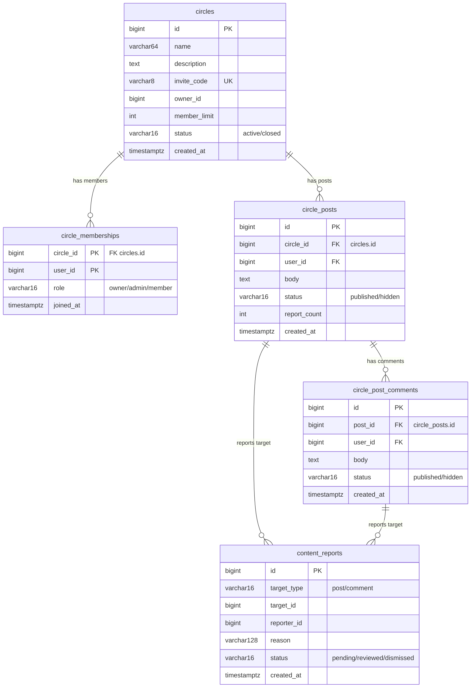

# SDD — 圈子社区服务(community-go)详细设计

> 版本:1.0  日期:2026-08-17
> 关联:`crdb-schema.sql`(esp_community)、`34-community-go.yaml`、`app-data-matrix.md`(§1 圈子社区域)
> 端口:8097  语言:Go 1.25(gin)  schema:`esp_community`
> 代码行数:646 行(main.go 单文件 + main_test.go 199 行)

---

## 1. 模块设计

```
services/community-go/
  src/
    main.go          # 路由 + 全部 handler + helpers(646 行,单文件)
    main_test.go     # 单元测试:filterBlocked / genInviteCode / requireAuth / constants
```

**服务定位**:圈子社区微服务 -- 建圈/邀请加入/发帖/评论/举报五域合一。身份由 BFF 注入可信 `X-User-Id`/`X-Role` 头(EdgeAuthHandler 已剥离外网伪造)。数据隔离于 `esp_community` 独立 schema。

**职责边界**:

| 职责 | 归属 | 备注 |
|---|---|---|
| 圈子 CRUD | community-go | 建圈/搜索/详情/我的圈子 |
| 成员管理 | community-go | 加入(邀请码)/退出/角色检查 |
| 帖子与评论 | community-go | 发帖/列表(游标翻页)/评论 |
| 举报与自动隐藏 | community-go | 举报计数达阈值(3)自动 hidden |
| 关键词过滤 | community-go | 写时 BLOCKED_WORDS 过滤(环境变量可配) |
| 通知/推荐 | **缺失** | 未来应发 Pulsar 事件供通知/推荐服务消费 |

**代码结构说明**:当前全部逻辑集中于 `main.go` 单文件(无分包),handler/helper/常量/路由混在一起。646 行尚可接受,但后续加缓存/事件需拆分。

## 2. 架构

### 2.1 技术栈

- **框架**:Gin 1.10(单文件路由,无中间件链)
- **数据库**:CockroachDB(crdb-public:26257),schema `esp_community`
- **驱动**:pgx v5(通过 esp/common-go/db 封装)
- **公共包**:esp/common-go(config, db, health)
- **可观测性**:OTel SDK(Dockerfile 配 OTEL_EXPORTER_OTLP_ENDPOINT),但代码中**未显式初始化 trace span**

### 2.2 读写分离

```
readDB  = db.MustConnectDB(READ_DB_URL, ...)   // 只读查询
writeDB = db.MustConnectDB(WRITE_DB_URL, ...)   // 写入 + 计数
```

- **现状**:manifest 中 READ_DB_URL 和 WRITE_DB_URL **指向同一 DSN**(crdb-public:26257),未真正读写分离。
- **设计意图**:预留双池架构,后续部署 TiDB follower 或 CRDB follower 做只读。
- **建议**:正式上线前将 READ_DB_URL 指向 follower 节点,实现读写流量物理隔离。

### 2.3 缓存(当前缺失)

- **现状**:零缓存。每次帖子列表/评论列表/成员计数/角色查询均直接打 DB。
- **热点分析**:
  - `listPosts`:每圈子帖子列表,高频读,带游标翻页 + 关联子查询计数评论数。
  - `memberCount`/`isMember`/`memberRole`:每个帖子列表行都调 3 次 N+1 查询。
  - `listMembers`:成员列表 JOIN esp_auth.users(跨 schema)。
- **建议(架构层面,非本期实现)**:
  - L1 进程内缓存:成员关系(isMember/memberRole),TTL 60s,写入时 invalidate。
  - L2 Redis 缓存:帖子列表(热门圈子),member_count 计数器(Redis INCR/DECR 替代 COUNT(*))。
  - 用户显示名:esp_auth.users.name 应由 BFF 透传而非跨 schema 查询。

### 2.4 事件驱动(当前缺失)

- **现状**:所有写操作纯同步,无 Pulsar 事件发布。
- **建议**:帖子创建/举报达阈值隐藏/成员加入退出应发事件,供通知服务消费。

## 3. 接口

### 3.1 认证

所有写接口(POST)要求 BFF 注入 `X-User-Id` 头(正整数),通过 `requireAuth()` 校验。读接口部分需要认证(mine),部分不需要(公开发现)。

### 3.2 端点清单

| 方法 | 路径 | 认证 | 入参 | 出参(关键字段) | 说明 |
|---|---|---|---|---|---|
| GET | /healthz | 无 | - | 200+serviceName | 存活探针(health.GinHealthz) |
| GET | /livez | 无 | - | 200 | 存活(health.GinLivez) |
| GET | /readyz | 无 | - | 200{db_read:true} / 503 | 就绪:ping readDB |
| POST | /api/community/circles | 是 | {name, description, member_limit} | 201{id, invite_code} | 建圈(owner 自动入圈) |
| GET | /api/community/circles | 否 | ?q=&status=active | [{id,name,description,invite_code,owner_id,owner_name,member_limit,member_count,status,created_at,joined,my_role}] | 发现/搜索 |
| GET | /api/community/circles/mine | 是 | - | 同上(joined=true) | 我加入的圈 |
| GET | /api/community/circles/:id | 否 | - | {同上} | 圈子详情(含是否已加入) |
| GET | /api/community/circles/:id/members | 否 | - | [{user_id,name,role,joined_at}] | 成员列表(LEFT JOIN esp_auth.users) |
| POST | /api/community/circles/:id/join | 是 | {invite_code} | 200{id, joined/already_member} | 邀请码加入(大小写不敏感) |
| POST | /api/community/circles/:id/leave | 是 | - | 200{id, left} | 退出(owner 不可退) |
| POST | /api/community/circles/:id/posts | 是 | {body} | 201{id} | 发帖(仅成员,写时关键词过滤) |
| GET | /api/community/circles/:id/posts | 否 | ?cursor=&limit=20 | [{id,user_id,user_name,body,status,report_count,comment_count,created_at}] | 帖子列表(游标翻页,评论数子查询) |
| POST | /api/community/posts/:id/comments | 是 | {body} | 201{id} | 评论(仅成员,写时关键词过滤) |
| GET | /api/community/posts/:id/comments | 否 | - | [{id,user_id,user_name,body,created_at}] | 评论列表(仅 published) |
| POST | /api/community/reports | 是 | {target_type, target_id, reason} | 201{report_count, auto_hidden} | 举报帖子/评论 |

### 3.3 业务规则

| 规则 | 实现 |
|---|---|
| 邀请码 | 6位大写字母数字(去除易混淆 O/I/0/1),crypto/rand 安全随机,冲突重试最多 5 次 |
| 圈子上限 | member_limit 最大 500(超限默认 50) |
| Owner 退圈 | 禁止,需先转让 |
| 帖子字数 | body <= 2000 字(rune 计数) |
| 评论字数 | body <= 500 字(rune 计数) |
| 关键词过滤 | 写时 BLOCKED_WORDS(环境变量,默认赌博/诈骗/广告等),大小写不敏感,命中拒绝发布 |
| 举报自动隐藏 | pending 举报达 3 条(status=hidden,report_count 更新) |
| 帖子翻页 | 游标翻页(cursor = 上一页最小 id),每页默认 20,最大 50 |

## 4. 数据模型(esp_community)

### 4.1 ER 图



### 4.2 字段说明

**circles(圈子主表)**:
- `invite_code`:唯一索引(uk_invite_code),6 位,建圈时生成。
- `status`:active/closed(代码中未实现 close 逻辑,预留)。
- `idx_owner`:owner_id 索引(代码中未使用 owner_id 查询,预留)。

**circle_memberships(成员关系)**:
- 联合主键(circle_id, user_id),ON CONFLICT DO UPDATE role。
- `idx_user`:user_id 索引(支持 myCircles 按 user_id 查询)。
- 角色层级:owner > admin > member(代码中仅使用 owner 判断退圈权限)。

**circle_posts(帖子)**:
- `idx_circle_time`:(circle_id, created_at)复合索引(代码中实际用 id DESC 翾页,索引未完全覆盖)。
- status 由举报计数触发 hidden(阈值 3)。

**circle_post_comments(评论)**:
- `idx_post`:post_id 索引。
- status 与帖子同逻辑。

**content_reports(举报)**:
- 无唯一索引,未防重复举报(同一用户可多次举报同一目标)。
- `idx_target`缺失:举报计数查询 `WHERE target_type=$1 AND target_id=$2 AND status='pending'` 无索引覆盖,全表扫描隐患。

## 5. 异常处理

### 5.1 举报阈值自动隐藏

```
举报提交 → INSERT content_reports → SELECT count(*) WHERE status='pending'
→ cnt >= 3 ? UPDATE target SET status='hidden', report_count=cnt : 跳过
```

**问题(铁律三态追踪)**:
1. **同步计数**:count(*) 在写事务外执行,非原子操作。高并发下两个举报可能都看到 cnt=2,都执行隐藏。
2. **未去重**:同一用户可多次举报同一目标(无 UK(target_type, target_id, reporter_id))。
3. **未发事件**:隐藏后无通知/事件,帖子作者不知情。
4. **reviewed/dismissed 状态未实现**:举报提交后永远 pending,无管理后台审核。

### 5.2 权限检查矩阵

| 操作 | 最低角色 | 实现方式 |
|---|---|---|
| 建圈 | 认证用户(自动 owner) | requireAuth + INSERT owner |
| 加入 | 认证用户 + 有效邀请码 | inviteCode 比对 + memberCount < limit |
| 退圈 | 非 owner | memberRole != "owner" |
| 发帖/评论 | 圈子成员 | isMember 查询 |
| 举报 | 认证用户 | requireAuth |
| 删除帖子 | **未实现** | owner/admin 无删除权限 |
| 转让所有权 | **未实现** | owner 不可退圈,但无转让逻辑 |

### 5.3 错误处理模式

- 500:DB 错误直接透传(暴露内部错误信息)。
- 401:无 X-User-Id 头。
- 403:权限不足/邀请码错误/圈满/内容被过滤。
- 404:圈子/帖子不存在。
- **不足**:错误响应无统一错误码格式(部分用 error 字段,部分用 message 字段)。

## 6. 运维

### 6.1 部署

- **manifest**:`deploy/k8s/34-community-go.yaml`
- **replicas**:1(单副本),HPA max=2(CPU>70%)
- **资源**:requests 50m/128Mi,limits 500m/256Mi(CPU request 被降级,因单节点资源紧张)
- **PDB**:缺失(应补 minAvailable:1 的 PDB)
- **preStop**:sleep 5(优雅终止)

### 6.2 健康检查

| 探针 | 路径 | 周期 | 超时 | 失败阈值 |
|---|---|---|---|---|
| startup | /livez | 10s | 5s | 30(5min) |
| readiness | /readyz | 15s | 5s | 5 |
| liveness | /livez | 20s | 5s | 3 |

- `readyz`:ping readDB 连接池,返回{db_read:true/false}。
- `livez`:gin 基础存活(无需 DB)。

### 6.3 监控

- **OTel**:Dockerfile 配置了 OTEL_EXPORTER_OTLP_ENDPOINT,但代码中**未创建 trace span**(无 `otel.StartSpan` 调用)。
- **Grafana**:deploy/grafana/esp-dashboard.json 未包含 community-go 行。
- **建议**:补齐 OTel span(每个 handler 入口) + Grafana 面板行。

### 6.4 不合规项(铁律对标)

| # | 不合规项 | 严重度 | 铁律引用 |
|---|---|---|---|
| 1 | 缓存缺失:帖子列表/成员计数 N+1 查询直打 DB | 中 | 架构约定(读写分离+缓存) |
| 2 | Pulsar 事件缺失:无领域事件发布 | 中 | 架构约定(事件驱动) |
| 3 | 举报 auto_hidden 同步计数,非事件驱动 | 低 | 工程铁律(设计三态追踪) |
| 4 | content_reports 缺 UK(target_type, target_id, reporter_id) 防重复举报 | 中 | 工程铁律(幂等) |
| 5 | content_reports 缺 idx_target 索引 | 中 | 性能(举报计数全表扫描) |
| 6 | 500 错误直接透传内部错误 | 低 | 安全(信息泄露) |
| 7 | 无统一错误码格式 | 低 | API 一致性 |
| 8 | OTel span 未实现(Dockerfile 配了但代码没用) | 低 | 可观测性 |
| 9 | Grafana 面板无 community-go 行 | 低 | 可观测性 |
| 10 | PDB 缺失 | 低 | 韧性(Phase2) |
| 11 | 单文件 646 行未拆包 | 低 | 可维护性(当前阈值可接受) |
| 12 | 业务能力地图 mindmap 未含社区能力域 | 低 | TOGAF Phase B 完整性 |

---

## 7. DDD 领域建模

> 以下为架构层面的领域分析,非代码实现要求。当前代码为单文件 CRUD,未显式 DDD 分层。

### 7.1 限界上下文:Community BC

圈子社区是 ESP 平台的**社交协作**限界上下文,与其他 BC 的关系:

```
Community BC <---> Auth BC(跨 schema JOIN esp_auth.users,获取用户名)
Community BC <---> Notification BC(未来:举报隐藏/成员加入事件)
Community BC <---> Gamification BC(未来:建圈/发帖成就触发)
```

**防腐层**:当前 `userDisplayName()` 通过跨 schema JOIN esp_auth.users 获取用户名,这是**跨 BC 直连反模式**。应在防腐层由 BFF 透传 user_name 或走 HTTP API 查询。

### 7.2 聚合设计

**聚合根:Circle(圈子)**
- 聚合内含:Membership 列表(成员关系)、Post 列表(帖子)
- 一致性边界:建圈时 owner 自动入圈(INSERT circles + INSERT circle_memberships,非事务但顺序保证)
- 不变量:member_count <= member_limit; owner 不能退圈

**聚合根:Post(帖子)**
- 聚合内含:Comment 列表(评论)、Report 列表(举报)
- 一致性边界:举报计数达阈值自动隐藏
- 不变量:只有成员能发帖/评论; body 需通过关键词过滤

**值对象**:
- `MemberRole`:owner / admin / member(枚举值,代码中以 string 表示)
- `InviteCode`:6 位大写字母数字,唯一,不可变
- `ContentStatus`:published / hidden(帖子/评论生命周期状态)
- `ReportReason`:举报原因(自由文本,128 字符上限)

### 7.3 领域事件

| 事件 | 触发时机 | 消费者(建议) | 当前状态 |
|---|---|---|---|
| CircleCreated | 建圈成功 | 通知服务(owner 通知) | **未实现** |
| MemberJoined | 加入圈子 | 通知服务(circle 成员)、Gamification(建圈成就) | **未实现** |
| MemberLeft | 退出圈子 | 通知服务(circle 成员) | **未实现** |
| PostCreated | 发帖成功 | 通知服务(circle 成员)、推荐服务 | **未实现** |
| CommentCreated | 评论成功 | 通知服务(帖子作者) | **未实现** |
| ReportThresholdReached | 举报达 3 条 | 通知服务(帖子作者)、管理后台(审核队列) | **未实现** |

### 7.4 领域服务

**ModerationService(内容审核服务)**:
- 当前逻辑:createReport handler 中同步计数 + 更新 status
- 理想设计:举报提交 → 发 ReportSubmitted 事件 → ModerationService 消费 → 原子 UPDATE ... WHERE report_count < threshold + ON CONFLICT → 达阈值发 ReportThresholdReached 事件
- 好处:异步解耦、原子计数(避免并发双触发)、可扩展(接入 AI 审核/人工审核队列)

**MemberService(成员管理服务)**:
- join/leave/isMember/memberRole 聚合为领域服务
- 不变量检查:入圈前检查 member_count < member_limit(当前用 COUNT(*) 查询,应改 Redis INCR 原子操作)

---

## 8. 改进建议(按优先级)

### P0 - 上线阻断

| # | 建议 | 原因 |
|---|---|---|
| 1 | content_reports 加 UK(target_type, target_id, reporter_id) | 防同一用户重复举报刷阈值 |
| 2 | content_reports 加索引 idx(target_type, target_id, status) | 举报计数查询避免全表扫描 |

### P1 - 架构补齐

| # | 建议 | 原因 |
|---|---|---|
| 3 | 帖子列表/成员计数加 Redis 缓存(L1 进程内 or L2 Redis) | N+1 查询性能隐患 |
| 4 | Pulsar 事件发布:PostCreated / MemberJoined / ReportThresholdReached | 通知/推荐/审核依赖事件 |
| 5 | 举报 auto_hidden 改为事件驱动(异步 + 原子计数) | 避免同步计数竞态 |
| 6 | userDisplayName 跨 schema JOIN 改为防腐层(BFF 透传) | 跨 BC 直连反模式 |
| 7 | 补齐 OTel span(每个 handler 入口) | 可观测性完整性 |

### P2 - 体验与治理

| # | 建议 | 原因 |
|---|---|---|
| 8 | 错误响应统一格式:{"code":"CIRCLE_NOT_FOUND","message":"..."} | API 一致性 |
| 9 | 补 PDB(minAvailable:1) | 韧性 |
| 10 | Grafana 面板加 community-go 行 | 监控完整性 |
| 11 | 举报管理后台(reviewed/dismissed 状态流转) | 内容治理完整性 |
| 12 | 业务能力地图 mindmap 补"社区协作"一级能力 | TOGAF Phase B 完整性 |
