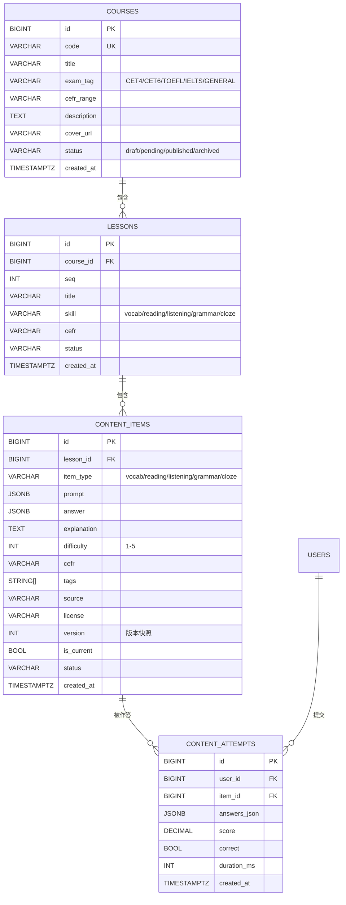

# SDD — 内容库服务(content-go)详细设计

> 版本:1.0  日期:2026-08-17
> 关联:`crdb-schema.sql`(esp_content 段)、`srs-content-go.md`(待补)、`adr-schema-per-service.md`、`architecture/business-event-catalog.md`
> 端口:8096  语言:Go(Gin)  schema:`esp_content` + `esp_learning`(outbox 跨域写)
> 代码规模:main.go 505 行 + outbox_relay.go 133 行 + outbox_relay_test.go 299 行 = 937 行

---

## 1. 模块设计(概述)

### 1.1 服务定位

content-go 是 ESP Phase1 功能拓展的**统一内容库微服务**,负责:

- **内容目录 CRUD**:课程(course) → 课时(lesson) → 题目(content_item) 四层树形结构管理
- **作答判分**:submitAnswer 按题型自动判分,写 content_attempts 留痕
- **事件中继**:作答事件写 learning_event_outbox,经 outbox_relay 自投 CRDB learning_events,供 gamification-go(XP) / learning-java(掌握度) 消费
- **批量导入**:管理端 import 批量灌入题目(1..5000 items/batch)

支持考试标签:CET4 / CET6 / TOEFL / IELTS / GENERAL;内容版权标注(source/license 字段强制)。

### 1.2 职责边界

| 归属 content-go | 归属其他服务 |
|---|---|
| courses/lessons/content_items CRUD | scenarios 表(CRDB esp_content 内,但 CRUD 由 gateway-go 管理) |
| content_attempts 写入 + 判分 | 掌握度计算(learning-java) |
| learning_event_outbox 写入 | outbox relay 消费 → learning_events |
| 批量 import | 种子脚本(直连 CRDB) |

### 1.3 与其他服务关系

```
content-go ──(outbox_relay, 2s 轮询)──→ esp_learning.learning_events
                                              ↓
                                    gamification-go(XP/排行榜)
                                    learning-java(掌握度更新)

content-go ──(学习端 HTTP)──→ BFF(auth/auth-filter) ──→ 前端(Web/H5/小程序)
content-go ──(管理端 HTTP)──→ frontend-react(/admin/content)
```

### 1.4 文件结构

```
services/content-go/
  src/
    main.go             # 505 行:路由/handler/grade/emit/CRUD
    outbox_relay.go     # 133 行:CRDB outbox 轮询重投器
    outbox_relay_test.go# 299 行:grade/backoff/userID/roleOf/importBatch 单测
  Dockerfile            # 多阶段 golang:1.25-alpine + alpine:3.22
  go.mod                # 依赖:gin + esp/common-go(db/config/health)
```

---

## 2. 架构

### 2.1 技术栈

| 组件 | 选型 | 说明 |
|---|---|---|
| 语言 | Go 1.25 | CGO_ENABLED=0 静态编译 |
| HTTP 框架 | Gin 1.10 | release 模式 |
| 数据库 | CockroachDB v24.3 | pgx v5 驱动, esp_content schema |
| 连接池 | esp-common-go/db | MustConnectDB 单池(readDB + writeDB 独立) |
| OTel | opentelemetry-otel | DTrace 端点(esp-observability) |

### 2.2 进程模型

```
content-go 进程
  ├── HTTP Server(:8096, Gin)
  │     ├── /healthz → health.GinHealthz(serviceName)
  │     ├── /livez   → health.GinLivez()
  │     ├── /readyz  → readDB.PingContext()
  │     └── /api/content/* → handlers
  └── Outbox Relay Goroutine
        └── ticker(2s) → drainOutbox()
              ├── poll: pending/failed WHERE next_retry_at <= now LIMIT 200
              ├── insert: esp_learning.learning_events (ON CONFLICT DO NOTHING)
              └── mark: done / backoff / dead
```

### 2.3 读写分离双池

当前实现:**未使用 esp-common-go/db 双池 API**(MustConnectReadWrite),而是手动创建两个独立 *sql.DB:

- `readDB`: 所有 SELECT 查询(课程列表/详情/课时/题目/判分读题)
- `writeDB`: 所有 INSERT/UPDATE(attempts/outbox/CRUD)

**与 esp-common-go 的差距**:未使用 db.Pool 的 Read()/Write() 统一接口,也未开启 follower-read(followerReadParam)。读池 DSN 与写池同址(crdb-public:26257),无物理读写分离。

> **改进建议(I-1)**:迁移至 `db.MustConnectReadWrite(readDSN, writeDSN, serviceName)` 获得 follower-read + fallback 能力;多阶段 CRDB_READ_HOST 指向 follower 节点时读池自动走本地副本,代码零改动。

### 2.4 数据库连接参数

| 参数 | 值 | 说明 |
|---|---|---|
| READ_DB_URL | `postgres://root@crdb-public:26257/esp_content?sslmode=disable` | 环境变量可覆盖 |
| WRITE_DB_URL | `postgres://root@crdb-public:26257/esp_content?sslmode=disable` | 同上 |
| MaxOpenConns | 10 | esp-common-go/db 默认 |
| MaxIdleConns | 2 | 同上 |
| PORT | 8096 | 环境变量可覆盖 |

---

## 3. 接口

### 3.1 健康检查

| 方法 | 路径 | 认证 | 说明 |
|---|---|---|---|
| GET | `/healthz` | 无 | 进程存活(gin.Recovery + 基础) |
| GET | `/livez` | 无 | 存活探针(200 即可) |
| GET | `/readyz` | 无 | 就绪探针(readDB.Ping;503 = DB 不可达) |

### 3.2 学习端 API(任意登录用户)

| 方法 | 路径 | 认证 | 入参 | 出参 | 说明 |
|---|---|---|---|---|---|
| GET | `/api/content/courses` | JWT | `?exam_tag=&status=published` | `[{id,code,title,exam_tag,cefr_range,description,status}]` | 课程列表;status=all 管理端全状态 |
| GET | `/api/content/courses/:id` | JWT | — | `{id,code,title,exam_tag,cefr_range,description}` | 课程详情;仅 published |
| GET | `/api/content/courses/:id/lessons` | JWT | — | `[{id,course_id,seq,title,skill,cefr}]` | 课时列表;按 seq 排序;仅 published |
| GET | `/api/content/lessons/:id/items` | JWT | — | `[{id,lesson_id,item_type,prompt,difficulty,cefr,tags}]` | 题目列表;不含 answer;仅 published+is_current |
| POST | `/api/content/items/:id/answer` | JWT | `{answers,duration_ms}` | `{correct,score,explanation}` | 提交作答;判分+写 attempts+发事件 |

**submitAnswer 判分规则**:

| item_type | 判分逻辑 | score |
|---|---|---|
| vocab | 自测词卡,始终 correct=true | 1 |
| reading/listening/grammar/cloze | 单选:比较 submitted.option_index 与 answer.correct_option | 正确=100,错误=0 |

**请求体示例**(submitAnswer):
```json
{
  "answers": {"option_index": 2},
  "duration_ms": 15000
}
```

**响应体示例**:
```json
{
  "correct": true,
  "score": 100,
  "explanation": "The correct answer is C because..."
}
```

### 3.3 管理端 API(role=admin)

| 方法 | 路径 | 认证 | 入参 | 出参 | 说明 |
|---|---|---|---|---|---|
| POST | `/api/content/courses` | admin | `{code,title,exam_tag,cefr_range,description}` | `{id}` | 创建课程 |
| PUT | `/api/content/courses/:id` | admin | `{title,status,cefr_range}` | `{id}` | 更新课程(含状态流转) |
| POST | `/api/content/lessons` | admin | `{course_id,seq,title,skill,cefr}` | `{id}` | 创建课时 |
| POST | `/api/content/items` | admin | `{lesson_id,item_type,prompt,answer,explanation,difficulty,cefr,tags,source,license}` | `{id}` | 创建题目 |
| PUT | `/api/content/items/:id` | admin | `{status, edit?:{...}}` | `{id}` 或 `{id,superseded}` | 状态流转+编辑建新版本(is_current 快照) |
| POST | `/api/content/import` | admin | `[{lesson_id,item_type,prompt,...},...]` | `{created}` | 批量导入(1..5000 items) |

**itemInput 结构**:
```json
{
  "lesson_id": 1,
  "item_type": "reading",
  "prompt": {"passage": "...", "options": ["A", "B", "C", "D"]},
  "answer": {"correct_option": 2},
  "explanation": "...",
  "difficulty": 3,
  "cefr": "B1",
  "tags": ["topic-education", "type-inference"],
  "source": "ESP Original",
  "license": "CC-BY-4.0"
}
```

### 3.4 鉴权机制

所有 /api/content/* 端点依赖 BFF 注入可信头:

| 头 | 用途 | 来源 |
|---|---|---|
| `X-User-Id` | 用户 ID(int64) | BFF EdgeAuthHandler 剥离外网伪造 |
| `X-Role` | 角色(learner/admin) | 同上;默认 "learner" |

admin 接口通过 `requireAdmin` 中间件校验 X-Role=="admin",否则 403。

### 3.5 错误码体系

| HTTP 状态码 | 场景 | 响应体 |
|---|---|---|
| 200 | 成功 | 业务数据 |
| 201 | 创建成功 | `{id}` 或 `{created}` |
| 400 | 请求体校验失败 / 批量导入空/超限 | `{error:"..."}` |
| 401 | 未登录(X-User-Id 缺失或 <=0) | `{error:"unauthorized"}` |
| 403 | 非 admin 访问管理接口 | `{error:"admin required"}` |
| 404 | 资源不存在(课程/题目) | `{error:"not found"}` / `{error:"item not found"}` |
| 500 | DB 错误 | `{error:"..."}` |

> **改进建议(I-2)**:统一错误码体系(业务错误码而非裸 error string),便于前端国际化和监控聚合。

---

## 4. 数据模型(esp_content)

### 4.1 ER 图



### 4.2 表说明

| 表 | 行数(种子) | 索引 | 说明 |
|---|---|---|---|
| courses | ~10 | uk_course_code(CODE) | 课程目录;code 唯一(cet4/cet6/toefl/ielts) |
| lessons | ~50 | idx_course_seq(COURSE_ID, SEQ) | 课时;按课程+序号排列 |
| content_items | ~1342 | idx_lesson(LESSON_ID), idx_current(IS_CURRENT, STATUS) | 题目;版本快照(is_current) |
| content_attempts | ~4 | idx_user_item(USER_ID, ITEM_ID), idx_item(ITEM_ID) | 作答记录;进度真源 |
| scenarios | ~10 | uk_code(CODE) | 场景定义(content-go 持有 schema,CRUD 由 gateway-go 管理) |

### 4.3 版本快照机制

content_items 使用 `is_current` + `version` 实现不可变快照:

1. 新建题目: `is_current=true, version=1`
2. 编辑更新: 旧版 `is_current=false`,新建行 `is_current=true, version=旧version+1`
3. 浏览/判分: 仅查 `is_current=true` 的行
4. 历史追溯: 保留所有旧版本(is_current=false)

> **改进建议(I-3)**:当前 updateItem 未递增 version 字段(insertItem 固定 version=1);应从旧版 version+1 取值。

### 4.4 状态生命周期

```
draft → pending → published → archived
  ↑         ↑         ↓
  └─────────┴─────────┘ (任意状态可回退到 draft)
```

学习端仅可见 `status='published'` 的数据;管理端通过 `status=all` 查看全状态。

---

## 5. 依赖

### 5.1 外部依赖

| 依赖 | 用途 | 连接方式 |
|---|---|---|
| CRDB crdb-public:26257 | esp_content 读写 + esp_learning.learning_event_outbox 写 | PG wire(pgx v5) |
| BFF(auth-filter) | JWT 校验 + X-User-Id/X-Role 注入 | HTTP(内部 ClusterIP) |
| esp-common-go | config / db / health 共享包 | Go module(replace 指令) |

### 5.2 公共包依赖

| 包 | 用途 |
|---|---|
| esp-common-go/config | Getenv 读取环境变量 |
| esp-common-go/db | MustConnectDB 连接池 |
| esp-common-go/health | GinHealthz / GinLivez 探针 |

### 5.3 跨域写(关键路径)

content-go 跨域写 `esp_learning.learning_event_outbox`(content schema → learning schema):

```sql
INSERT INTO esp_learning.learning_event_outbox (message_id, user_id, event_type, payload)
VALUES ($1,$2,$3,$4::jsonb)
```

outbox_relay 同样跨域读写:

```sql
-- 读: esp_learning.learning_event_outbox
-- 写: esp_learning.learning_events (ON CONFLICT message_id DO NOTHING)
```

**风险**:跨 schema 写入依赖 CRDB 的多 schema 跨库写能力(同一 CRDB 集群内合法);TiDB 单库模式下需确认权限。

---

## 6. 异常处理

### 6.1 Outbox Relay 重试策略

```
pending/failed → 每 2s 轮询 → 批量 200 行
  ├── INSERT learning_events 成功/冲突 → mark done
  ├── INSERT 失败:
  │     ├── retry_count < 8 → 指数退避
  │     │     retry=1 → 1s, retry=2 → 5s, retry=3 → 30s, retry=4+ → 300s
  │     └── retry_count >= 8 → mark dead(死信)
  └── 部分失败: 成功行 done, 失败行退避/dead
```

> **改进建议(I-4)**:outbox_relay.go 的 relayDoneSQL 使用 `status='done'`,但 learning_event_outbox 表的 CHECK 约束仅允许 `pending/failed/done`;dead 状态写入会违反约束。需 ALTER TABLE 补充 `dead` 状态(或 relayDeadSQL 仅更新 retry_count 不改 status)。
>
> **实测确认**:schema.sql 的 CHECK 为 `status IN ('pending','done','failed')`,无 `dead`;relayDeadSQL 执行 `SET status='dead'` 会违反约束导致静默失败。

### 6.2 DB 不可达降级

- readyz 探针: readDB.Ping 失败返回 503,阻止流量导入
- 读查询失败: 直接返回 500 error JSON,无 fallback
- 写操作失败: 返回 500,不重试(应用层无重试)

> **改进建议(I-5)**:读查询可增加 readDB→writeDB fallback(参考 esp-common-go/db Pool.Read 的 fallback 逻辑);写操作可增加写重试(幂等 INSERT 可安全重试)。

### 6.3 批量导入部分失败

当前 importBatch 逐条 INSERT,任一失败立即返回 500 + index,但**前面已成功的行不回滚**(无事务包裹)。

> **改进建议(I-6)**:importBatch 应包裹在 CRDB 事务中(`BEGIN; INSERT...; COMMIT`),任一失败整体 ROLLBACK,保证原子性。

---

## 7. DDD — Content Library 有界上下文

### 7.1 限界上下文

**Content Library BC**:统一内容库,管理课程/课时/题目的生命周期,提供作答判分能力,产出学习事件供学情管线消费。

- 核心域:内容目录管理 + 作答判分
- 支撑域:事件中继(outbox relay)
- 通用域:认证鉴权(BFF 注入,非本服务职责)

### 7.2 聚合根

| 聚合根 | 包含实体 | 说明 |
|---|---|---|
| **Course** | Lesson(列表) | 课程聚合;创建课程时隐式创建 lesson 列表;状态流转课程级 |
| **ContentItem** | 独立原子 | 题目聚合;版本快照(is_current);支持编辑建新版本 |

### 7.3 值对象

| 值对象 | 类型 | 枚举值 |
|---|---|---|
| **Difficulty** | INT | 1(最易) ~ 5(最难), 默认 3 |
| **ContentType** | VARCHAR(16) | vocab / reading / listening / grammar / cloze |
| **ExamTag** | VARCHAR(16) | CET4 / CET6 / TOEFL / IELTS / GENERAL |
| **Status** | VARCHAR(16) | draft / pending / published / archived |
| **CEFR** | VARCHAR(16) | A1 / A2 / B1 / B2 / C1 / C2 |
| **AnswerResult** | struct | `{correct: bool, score: float64}` — 判分结果值对象 |

### 7.4 领域事件

| 事件 | 触发条件 | 生产者 | 消费者 | 载荷 |
|---|---|---|---|---|
| **CourseCreated** | POST /courses | content-go | (日志) | `{course_id, code, exam_tag}` |
| **LessonPublished** | PUT /lessons/:id status→published | content-go | (日志) | `{lesson_id, course_id, skill}` |
| **ContentAttempted** | POST /items/:id/answer | content-go | outbox_relay → learning_events | `{user_id, item_id, item_type, correct, score, duration_ms}` |
| **LearningEventReported** | outbox_relay 投递成功 | content-go(间接) | gamification-go(XP), learning-java(掌握度) | `{user_id, event_type, payload, message_id}` |

### 7.5 领域服务

| 领域服务 | 职责 | 实现位置 |
|---|---|---|
| **SubmitAnswerService** | 判分 + 写 attempts + 发事件 | main.go submitAnswer() + grade() + emitContentEvent() |
| **ContentVersioningService** | 编辑建新版本(is_current 快照) | main.go updateItem() |
| **OutboxRelayService** | outbox → learning_events 重投 | outbox_relay.go drainOutbox() |

### 7.6 仓储层

当前实现:handler 直接调用 readDB/writeDB 执行 SQL,无独立 repository 层。

> **改进建议(I-7)**:抽取 repository 接口(CourseRepository / LessonRepository / ContentItemRepository / ContentAttemptRepository),便于单元测试 mock 和未来切换 ORM/查询构建器。

---

## 8. 测试要点

### 8.1 单测(当前覆盖率)

当前 `outbox_relay_test.go` 覆盖:

| 测试函数 | 覆盖范围 | 通过 |
|---|---|---|
| TestRelayBackoffSec | 退避时间计算(6 cases) | Pass |
| TestRelayMaxRetryDead | 退避封顶常量 | Pass |
| TestGrade_Vocab_AlwaysCorrect | vocab 始终正确 | Pass |
| TestGrade_SingleChoice_Correct/Wrong/NoOptionIndex/NotAMap/NilSubmitted | 单选判分边界(6 cases) | Pass |
| TestGrade_AllTypes | 4 种题型批量判分 | Pass |
| TestGrade_EmptyAnswer/Float64Comparison | 边界条件 | Pass |
| TestRandID | 随机 ID 长度+唯一性(100次) | Pass |
| TestUserID/TestRoleOf | 身份解析(+边界) | Pass |
| TestRequireAdmin | 角色校验中间件 | Pass |
| TestImportBatch | 空批次/坏 JSON 校验 | Pass |

**未覆盖**: listCourses/listLessons/listItems/getCourse/submitAnswer/createCourse/updateCourse/createLesson/createItem/updateItem 的 DB 交互路径(需集成测试)。

### 8.2 集成测试(待补)

- testcontainers CRDB: 创建课程 → 创建课时 → 创建题目 → submitAnswer → 验证 attempts + outbox
- outbox relay 端到端: 写 outbox → 等待 relay → 验证 learning_events
- 批量导入: 5000 items 导入 → 验证 count

### 8.3 契约测试(待补)

- content-go → gamification-go: content_attempted 事件 Schema 契约
- content-go → learning-java: learning_event_outbox payload Schema 契约

---

## 9. 部署

### 9.1 Docker

```dockerfile
# 多阶段构建
FROM golang:1.25-alpine AS builder  # GOPROXY=goproxy.cn
FROM alpine:3.22                    # ca-certificates + 非 root app 用户
EXPOSE 8096
USER app
ENTRYPOINT ["/app/content-go"]
```

### 9.2 K8s

| 参数 | 值 | 说明 |
|---|---|---|
| replicas | 1(目标 3) | 单节点验证;多节点扩展 |
| requests | 100m CPU / 128Mi | 最低保障 |
| limits | 500m CPU / 512Mi | 峰值限制 |
| Service | ClusterIP | BFF 通过内部 DNS 访问 |
| HPA | CPU > 70% | 待配置 |

### 9.3 环境变量

| 变量 | 默认值 | 说明 |
|---|---|---|
| PORT | 8096 | HTTP 监听端口 |
| GIN_MODE | release | Gin 运行模式 |
| READ_DB_URL | postgres://root@crdb-public:26257/esp_content?sslmode=disable | 读池 DSN |
| WRITE_DB_URL | postgres://root@crdb-public:26257/esp_content?sslmode=disable | 写池 DSN |
| OTEL_SERVICE_NAME | content-go | OTel 服务名 |
| OTEL_EXPORTER_OTLP_ENDPOINT | http://otel-collector.esp-observability.svc.cluster.local:4317 | OTel 收集器 |

### 9.4 健康检查

| 探针 | 路径 | 超时 | 说明 |
|---|---|---|---|
| liveness | /livez | 1s(压测期 3s) | 进程存活 |
| readiness | /readyz | 1s | readDB.Ping;503 阻止流量 |

---

## 10. 改进建议汇总(代码审视)

| # | 类别 | 描述 | 优先级 | 影响 |
|---|---|---|---|---|
| I-1 | 架构 | 迁移至 db.MustConnectReadWrite 双池,获得 follower-read + fallback | P2 | 读性能/可用性 |
| I-2 | API | 统一错误码体系(业务码+消息),替代裸 error string | P3 | 前端国际化/监控 |
| I-3 | Bug | updateItem 编辑建新版本未递增 version 字段(固定 version=1) | P1 | 版本追溯断裂 |
| I-4 | Bug | relayDeadSQL 写 status='dead' 违反 CHECK 约束(pending/done/failed) | P1 | 死信静默失败 |
| I-5 | 可用性 | 读查询增加 readDB→writeDB fallback | P3 | DB 故障降级 |
| I-6 | 数据完整性 | importBatch 包裹事务,原子性导入 | P2 | 部分导入数据不一致 |
| I-7 | 架构 | 抽取 repository 接口,handler 与 DB 解耦 | P3 | 可测试性/可维护性 |
| I-8 | 缓存 | L1(sync.Map) + L2(Redis Cluster) 缓存课程/课时元数据 | P2 | 高频读低频写性能 |
| I-9 | 事件 | content_attempts 完成后发布 Pulsar 事件(替代 outbox relay 轮询) | P3 | 事件延迟(当前 2s) |
| I-10 | API | 路由版本化(/api/v1/content/...) | P3 | 向前兼容 |
| I-11 | 运维 | readyz 同时检查 writeDB | P3 | 写池不可达未感知 |
| I-12 | 测试 | 补充集成测试(CRDB testcontainers) + 契约测试 | P2 | 覆盖 DB 交互路径 |

---

## 11. 测试文档

| 文档 | 路径 | 说明 |
|---|---|---|
| SDD 本文 | `docs/design/sdd-content-go.md` | 详细设计(6 节 + DDD) |
| CRDB Schema | `scripts/crdb-schema.sql` L220-279 | esp_content 建表 DDL |
| 业务事件目录 | `docs/design/architecture/business-event-catalog.md` E-6/E-7 | content 事件登记 |
| 应用数据矩阵 | `docs/design/architecture/app-data-matrix.md` | esp_content CRUD 归属 |
| ER 图 | `docs/design/architecture/er-diagrams.md` | 逻辑层 content_attempts |
